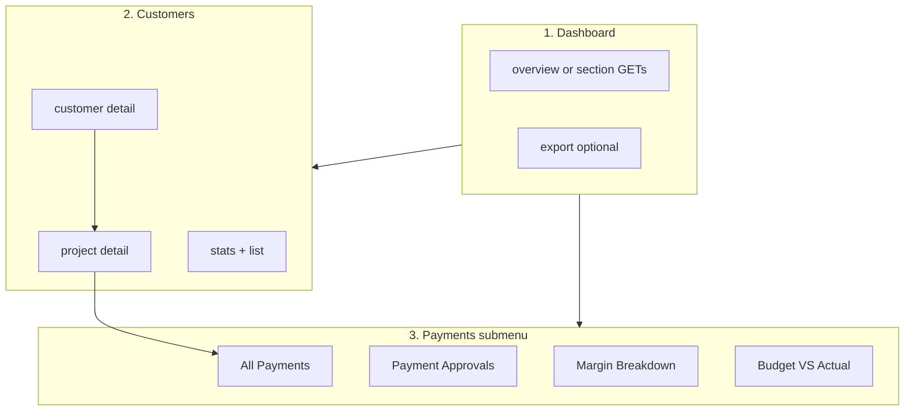

# Account panel — complete API guide (Figma flow)

**Updated:** 2026-10-15  
**Audience:** Frontend (Account + Admin)  
**Production base:** `https://mr-storage-backend-025k.onrender.com`  
**Base path:** `/api/account`  
**Auth:** `Authorization: Bearer <accessToken>`  
**Roles:** `account` | `admin`

**Response envelope (JSON routes):**

```json
{
  "success": true,
  "message": "Success",
  "data": { }
}
```

Errors: `{ "success": false, "message": "…" }` with HTTP 4xx/5xx.

**Related deep dives:**  
[`frontend-account-dashboard-api.md`](./frontend-account-dashboard-api.md) · [`frontend-account-payments-api.md`](./frontend-account-payments-api.md) · [`frontend-account-customers-api.md`](./frontend-account-customers-api.md) · [`frontend-account-project-detail-api.md`](./frontend-account-project-detail-api.md)

---

## Figma coverage matrix (backend status)

| Sidebar / screen | API status | Primary routes |
|------------------|------------|----------------|
| **Dashboard** — KPIs, invoice row, delivery finance, order vs plant | **Done** | `/api/account/dashboard/*` |
| **Dashboard** — transactions, alerts, carriers, vendors | **Done** | Included in `overview` or section GETs |
| **Dashboard** — upcoming payments, budget vs actual table | **Done** | `upcoming-payments`, `project-budget-vs-actual` |
| **Dashboard** — Export | **Done** | `GET /api/account/dashboard/export` |
| **Customers** — list + Today/Week/Month stats | **Done** | `/api/account/customers/stats`, `/customers` |
| **Customers** — detail (KPIs, profitability, revenue, projects, invoices) | **Done** | `GET /api/account/customers/:id` |
| **Customers** — mark invoice paid | **Done** | `PUT /api/account/invoices/:id/mark-paid` |
| **Customer → Project detail** | **Done** | `GET /api/account/projects/:projectId` |
| **Payments → All Payments** | **Done** | `/api/account/payments/*` |
| **Payments → Update / Add payment** | **Done** | POST/PUT `payments/orders`, GET detail modal |
| **Payments → Payment Approvals** | **Done** | `/api/account/financial/payment-approvals/*` |
| **Payments → Margin Breakdown** | **Done** | `/api/account/financial/margin-analysis/*`, `profit-loss/*` |
| **Payments → Budget VS Actual** | **Done** | `/api/account/financial/budget-vs-actual` |
| **Analytics → Income (project wise)** | **Done** | `GET /api/account/reports/project-wise-income` |
| **Analytics → Expense (project wise)** | **Done** | `GET /api/account/reports/project-wise-expense` |
| **Analytics → Profit/Loss Analysis** | **Done** | `/api/account/financial/profit-loss/*` (+ `GET /api/account/reports/profit-loss`) |
| **Expenses submenu** (Salary, Manpower, Misc, Freight, Logistics, Variance, Rent, Item list, Future) | **Done** | `/api/account/costs/*` |
| **Invoice Management** — Project / Vendor / Carrier / Misc / Quotation P&L | **Done** | `/api/account/invoice-management/*` |

**Expense totals (important):** Project/customer **actual cost** and Analytics **expense** screens combine:

1. **Manual** — active `Expense` rows on the project (`isActive: true`).
2. **Email vendor/material bids** — approved or pending vendor quotes on **`ShipperRequest`** (amount from `quoteValue` or sum of **`VendorQuoteLine`** for that request).
3. **Email freight bids** — **`FreightBid`** with `status: selected` (via project **`Delivery`**).

Amounts are **numbers in USD** in JSON; format Crores/Lakhs (`Cr` / `L`) on the frontend.

---

## Recommended screen flow



| # | Figma area | Load order |
|---|------------|------------|
| 1 | Financial Overview (full page) | `GET /api/account/dashboard/overview?startDate=&endDate=` |
| 2 | Customers list | `GET /api/account/customers/stats?period=month` + `GET /api/account/customers?period=month` |
| 3 | Customer Info | `GET /api/account/customers/:customerId` |
| 4 | Project detail (from customer) | `GET /api/account/projects/:jobIdOrLeadId` |
| 5 | All Payments | `GET /api/account/payments/stats` + `GET /api/account/payments/orders` |
| 6 | Payment Approvals | `GET /api/account/financial/payment-approvals/filters` then list |
| 7 | Margin Breakdown | `GET /api/account/financial/margin-analysis/filters` then KPIs + charts + table |
| 8 | Budget VS Actual | `GET /api/account/financial/budget-vs-actual` then `?leadId=` |

Shared query params (most KPI/list routes):

| Param | Description |
|--------|-------------|
| `startDate` | ISO date inclusive |
| `endDate` | ISO date inclusive (end of day) |
| `businessUnit` / `company` | Filter by lead business unit (Margin, Budget) |
| `projectId` / `leadId` | Scope to one project |

---

## 1. Financial Overview (dashboard)

### 1.1 Single load (recommended)

```http
GET /api/account/dashboard/overview?startDate=2025-03-24&endDate=2025-03-31&transactionsLimit=5&carriersLimit=5&vendorsLimit=5&budgetRowsLimit=6&daysAhead=30
Authorization: Bearer <token>
```

**Response `200` — `data`:**

```json
{
  "financialOverview": {
    "totalRevenue": 485250,
    "totalExpenses": 298750,
    "netProfit": 186500,
    "outstanding": 67890,
    "outstandingPayments": 67890
  },
  "invoiceReport": {
    "total": 48,
    "totalInvoicesGenerated": 48,
    "paid": 32,
    "unpaid": 12,
    "overdue": 4,
    "totalPaid": 420000,
    "totalUnpaid": 52000,
    "overdueAmount": 13390,
    "totalSales": 485390
  },
  "deliveryFinance": {
    "freightSpend": 248500,
    "pendingCarrierPayments": 62300,
    "freightSavings": 37400
  },
  "orderVsPlantCosts": {
    "totalOrderValue": 1230000,
    "totalPlantCosts": 997000,
    "projectedProfit": 233000
  },
  "recentTransactions": [
    {
      "id": "67a1b2c3d4e5f6789012345a",
      "type": "invoice",
      "label": "Payment Received",
      "entityName": "ABC Corp",
      "date": "2025-03-28T14:22:00.000Z",
      "amount": 25000,
      "direction": "credit",
      "status": "Completed",
      "invoiceNumber": "INV-2025-0042"
    }
  ],
  "alerts": [
    {
      "id": "67a1b2c3d4e5f6789012345c",
      "type": "invoice_due",
      "message": "Payment due from ABC Corp — $15,000",
      "priority": "high",
      "dueDate": "2025-04-01T00:00:00.000Z",
      "amount": 15000
    }
  ],
  "topCarriers": [
    {
      "carrierId": "67a1b2c3d4e5f6789012345e",
      "name": "FastFreight Logistics",
      "spend": 100000,
      "deliveries": 42
    }
  ],
  "topVendors": [
    {
      "vendorId": "67a1b2c3d4e5f67890123460",
      "name": "Olivia Harris Steel Supply",
      "contactName": "Olivia Harris",
      "amount": 145355,
      "status": "Active"
    }
  ],
  "upcomingPayments": [],
  "projectBudgetVsActual": [
    {
      "leadId": "67a1b2c3d4e5f67890123465",
      "projectName": "Downtown Office Complex",
      "jobId": "2025001",
      "material": 450000,
      "estimated": 420000,
      "actual": 465000,
      "variance": 45000,
      "varianceDirection": "over",
      "date": "2025-01-15T10:00:00.000Z"
    }
  ]
}
```

### 1.2 Export (header **Export** button)

```http
GET /api/account/dashboard/export?startDate=2025-03-24&endDate=2025-03-31
Authorization: Bearer <token>
```

**Response:** `200` — Excel (`account-dashboard-export.xlsx`), not JSON.

### 1.3 Granular routes (lazy sections)

| Figma block | GET |
|-------------|-----|
| Top 4 KPI cards | `/api/account/dashboard/stats?startDate=&endDate=` |
| Invoice row | `/api/account/dashboard/invoice-stats?startDate=&endDate=` |
| Delivery finance | `/api/account/dashboard/delivery-finance?startDate=&endDate=` |
| Order vs plant | `/api/account/dashboard/order-vs-plant-costs?startDate=&endDate=` |
| Recent transactions | `/api/account/dashboard/recent-transactions?limit=5` |
| Alerts | `/api/account/dashboard/alerts?limit=8` |
| Top carriers | `/api/account/dashboard/top-carriers?limit=5` |
| Top vendors | `/api/account/dashboard/top-vendors?limit=5` |
| Budget vs actual teaser | `/api/account/dashboard/project-budget-vs-actual?limit=6` |

Example **`GET /api/account/dashboard/stats`** response `data`:

```json
{
  "totalRevenue": 485250,
  "totalExpenses": 298750,
  "netProfit": 186500,
  "outstanding": 67890,
  "outstandingPayments": 67890
}
```

### 1.4 Lower dashboard widgets (second Figma screen)

All of the following are included in **`GET /api/account/dashboard/overview`** or available as standalone routes.

#### Recent transactions

```http
GET /api/account/dashboard/recent-transactions?limit=5&startDate=2025-03-01&endDate=2025-03-31
```

**Response `data.transactions[]`:**

```json
{
  "id": "67a1b2c3d4e5f6789012345b",
  "type": "expense",
  "label": "Labour Payment",
  "entityName": "Construction Team A",
  "date": "2024-01-14T00:00:00.000Z",
  "amount": 8750,
  "direction": "debit",
  "status": "Completed",
  "category": "labour"
}
```

UI: prefix **`+`** when `direction === "credit"`; debit styling when `"debit"`.

#### Alerts & notifications

```http
GET /api/account/dashboard/alerts?limit=8
```

**Response `data.alerts[]`:**

```json
{
  "id": "67a1b2c3d4e5f6789012345c",
  "type": "invoice_due",
  "message": "Payment due from ABC Corp — $15,000",
  "priority": "high",
  "dueDate": "2025-04-01T00:00:00.000Z",
  "amount": 15000
}
```

| `priority` | Figma styling |
|------------|----------------|
| `high` | Red / High Priority |
| `medium` | Yellow / Medium Priority |
| `low` | Blue / Low Priority |

#### Top carriers by spend

```http
GET /api/account/dashboard/top-carriers?limit=5&startDate=2025-01-01&endDate=2025-03-31
```

**Response `data.carriers[]`:** `{ carrierId, name, spend, deliveries }` — columns **Customer**, **Spend**, **Deliveries**.

#### Top vendors

```http
GET /api/account/dashboard/top-vendors?limit=5
```

**Response `data.vendors[]`:** `{ vendorId, name, contactName, amount, status }` — **`Active`** | **`Expired`**.

#### Upcoming payments (from sales)

```http
GET /api/account/dashboard/upcoming-payments?daysAhead=30
```

**Response `data.upcoming[]`:**

```json
{
  "_id": "67a1b2c3d4e5f67890123461",
  "companyName": "ABC Industries",
  "paymentDescription": "Progress Payment",
  "amount": 135000,
  "dueDate": "2025-04-25T00:00:00.000Z",
  "salesRep": "John Doe",
  "invoiceNumber": "INV-2024-001",
  "priority": "high"
}
```

#### Project budget vs actual (dashboard table)

```http
GET /api/account/dashboard/project-budget-vs-actual?limit=6
```

**Response `data.projects[]`:**

```json
{
  "leadId": "67a1b2c3d4e5f67890123465",
  "projectName": "Downtown Office Complex",
  "jobId": "2025001",
  "material": 450000,
  "estimated": 420000,
  "actual": 465000,
  "variance": 45000,
  "varianceDirection": "over",
  "date": "2024-01-15T10:00:00.000Z"
}
```

| Figma column | Field | Notes |
|--------------|--------|--------|
| Project | `projectName` | |
| Material | `material` | |
| Estimated | `estimated` | |
| Actual | `actual` | |
| Variance | `variance` | Use `varianceDirection`: `over` → red ↑, `under` → green ↓ |
| Date | `date` | |

---

## 2. Payments → All Payments (Payment Overview)

### 2.1 KPI cards

```http
GET /api/account/payments/stats?startDate=2025-03-01&endDate=2025-03-31
Authorization: Bearer <token>
```

Or `period=today|week|month` instead of explicit dates.

**Response `data`:**

```json
{
  "totalOrderValue": 1230000,
  "totalReceived": 845000,
  "outstanding": 385000,
  "totalWipProfit": 233000
}
```

### 2.2 Orders table

```http
GET /api/account/payments/orders?search=john&status=In%20progress&page=1&limit=20
Authorization: Bearer <token>
```

**Response `data`:**

```json
{
  "stats": {
    "totalOrderValue": 1230000,
    "totalReceived": 845000,
    "outstanding": 385000,
    "totalWipProfit": 233000
  },
  "orders": [
    {
      "wipId": "67a1b2c3d4e5f6789012345a",
      "leadId": "67a1b2c3d4e5f6789012345b",
      "orderDetails": {
        "customerName": "John Doe",
        "orderId": "Q-2025-1047",
        "quoteOrderId": "Q-2025-1047",
        "location": "Workshop, Texas"
      },
      "orderValue": 450000,
      "currentCost": 361000,
      "paymentBreakdown": {
        "deposit": 135000,
        "progress": 135000,
        "final": 0
      },
      "outstanding": 135000,
      "profit": 89000,
      "marginPct": 19.8,
      "status": "In progress",
      "statusCode": "in_progress",
      "totalReceived": 270000
    }
  ],
  "total": 42,
  "page": 1,
  "limit": 20
}
```

### 2.3 Export Reports

```http
GET /api/account/payments/orders/export?search=&status=all&startDate=2025-03-01&endDate=2025-03-31
Authorization: Bearer <token>
```

**Response:** Excel `payment-overview-orders.xlsx`.

### 2.4 View order (eye)

```http
GET /api/account/payments/orders/67a1b2c3d4e5f6789012345a
Authorization: Bearer <token>
```

Accepts WIP `_id`, lead `_id`, or job id `Q-2025-1047`.

**Response `data`:** Full row + `profile`, `financials`, `payments[]` — see [`frontend-account-payments-api.md`](./frontend-account-payments-api.md) §A3.

### 2.5 Add / update payment

```http
POST /api/account/payments/orders
Content-Type: application/json
Authorization: Bearer <token>

{
  "quoteOrderId": "Q-2025-1047",
  "orderValue": 450900,
  "currentCost": 361000,
  "depositPaid": 135000,
  "progressPaid": 135000,
  "finalPaid": 0,
  "status": "in_progress",
  "notes": ""
}
```

```http
PUT /api/account/payments/orders/Q-2025-1047
Content-Type: application/json
Authorization: Bearer <token>

{
  "depositPaid": 135000,
  "progressPaid": 135000,
  "finalPaid": 135000,
  "status": "completed"
}
```

**Dropdown before POST:**

```http
GET /api/account/payments/orders/options?search=warehouse&excludeWithWip=true&limit=50
```

**Response `data`:**

```json
{
  "options": [
    {
      "leadId": "67a1b2c3d4e5f6789012345b",
      "quoteOrderId": "Q-2025-1047",
      "label": "Q-2025-1047 — John Doe — ABC Warehouse",
      "projectName": "ABC Warehouse",
      "customerName": "John Doe",
      "location": "Workshop, Texas",
      "quoteValue": 450000,
      "lifecycleStatus": "payment_done",
      "hasWipRecord": false,
      "wipId": null
    }
  ],
  "total": 1
}
```

### 2.6 View modal (eye) — Order & Payment

```http
GET /api/account/payments/orders/QUO-990-009
Authorization: Bearer <token>
```

**Response `data` (fields for modal):**

```json
{
  "wipId": "67a1b2c3d4e5f6789012345a",
  "orderDetails": { "customerName": "John Doe", "quoteOrderId": "QUO-990-009", "location": "Workshop, Texas" },
  "orderValue": 450000,
  "financials": {
    "deposit": 46013.25,
    "progress": 46013.25,
    "final": 0,
    "profit": 23900,
    "outstanding": 0,
    "totalPayable": 14650,
    "totalReceived": 92026.5,
    "marginPct": 5.3
  },
  "paymentStatus": "In progress",
  "paymentStatusCode": "in_progress"
}
```

**Update** button → navigate to update form with same id, then **`PUT /api/account/payments/orders/:orderId`**.

### 2.7 Update Payment form (Figma)

Load existing row first:

```http
GET /api/account/payments/orders/QUO-9870-991
```

**Save:**

```http
PUT /api/account/payments/orders/QUO-9870-991
Content-Type: application/json

{
  "orderValue": 450900,
  "depositPaid": 135000,
  "progressPaid": 135000,
  "finalPaid": 135000,
  "status": "in_progress"
}
```

| Form field | Body key | Notes |
|------------|----------|--------|
| Quote/Order ID | URL param or `quoteOrderId` on POST | |
| Order Value | `orderValue` | Optional on PUT |
| Payment Deposit | `depositPaid` | |
| Payment Progress | `progressPaid` | |
| Final | `finalPaid` | |
| Profit / Margin % | — | **Server recalculates** on save |
| Payment Status | `status` | `in_progress` \| `started` \| `completed` \| `on_hold` |

---

## 3. Payments → Payment Approvals

### 3.1 Filters (dropdowns)

```http
GET /api/account/financial/payment-approvals/filters
Authorization: Bearer <token>
```

**Response `data`:**

```json
{
  "projects": [
    {
      "leadId": "67a1b2c3d4e5f6789012345b",
      "projectName": "Downtown Plaza",
      "jobId": "2025003",
      "businessUnit": "steel"
    }
  ],
  "payeeTypes": [
    { "code": "carrier", "label": "Carrier" },
    { "code": "delivery_company", "label": "Delivery Company" },
    { "code": "vendor", "label": "Vendor" }
  ],
  "statuses": ["pending", "under_review", "approved", "disputed", "rejected"],
  "workflowStages": ["pending", "under_review", "approved", "paid", "disputed"]
}
```

### 3.2 Stat cards

```http
GET /api/account/financial/payment-approvals/stats
Authorization: Bearer <token>
```

**Response `data`:**

```json
{
  "pendingApproval": 2,
  "underReview": 2,
  "approved": 1,
  "disputed": 1
}
```

### 3.3 Approval queue

```http
GET /api/account/financial/payment-approvals?search=FastTruck&status=pending&payeeType=carrier&project=67a1b2c3d4e5f6789012345b&page=1&limit=20
Authorization: Bearer <token>
```

**Response `data`:**

```json
{
  "stats": {
    "pendingApproval": 2,
    "underReview": 2,
    "approved": 1,
    "disputed": 1
  },
  "approvals": [
    {
      "approvalId": "67a1b2c3d4e5f6789012345c",
      "invoiceType": "Carrier",
      "invoiceTypeCode": "carrier",
      "companyName": "FastTruck Logistics",
      "invoiceNumber": "INV-2024-0345",
      "project": {
        "leadId": "67a1b2c3d4e5f6789012345b",
        "projectName": "Downtown Plaza",
        "jobId": "2025003"
      },
      "amount": 4500,
      "dueDate": "2024-04-15T00:00:00.000Z",
      "linkedTo": "Load: LD-0789",
      "linkedType": "freight_bid",
      "linkedId": "67a1b2c3d4e5f6789012345d",
      "status": "pending",
      "statusLabel": "Pending",
      "workflowStage": "pending",
      "paidAt": null,
      "category": "vendor_payment"
    }
  ],
  "total": 6,
  "page": 1,
  "limit": 20
}
```

When `status === "approved"` and `paidAt` is set: `statusLabel` = **`Paid`**, `workflowStage` = **`paid`**.

### 3.4 Detail modal (eye)

```http
GET /api/account/financial/payment-approvals/67a1b2c3d4e5f6789012345c
Authorization: Bearer <token>
```

**Response `data`:** Includes `invoiceDetails`, `companyInformation`, `costBreakdown`, `linkedTransaction`, `project` — see [`frontend-account-payments-api.md`](./frontend-account-payments-api.md) §B3.

### 3.5 Review action

```http
PUT /api/account/financial/payment-approvals/67a1b2c3d4e5f6789012345c/review
Content-Type: application/json
Authorization: Bearer <token>

{
  "action": "under_review",
  "reviewNotes": "Checking freight docs"
}
```

`action`: `under_review` | `approved` | `disputed` | `rejected`.  
`approved` sets `paidAt` to now (maps to workflow **Paid** in UI).

### 3.6 Export

```http
GET /api/account/financial/payment-approvals/export?status=pending&startDate=2024-04-01&endDate=2024-04-30
Authorization: Bearer <token>
```

**Response:** Excel `payment-approvals.xlsx`.

---

## 4. Payments → Margin Breakdown

### 4.1 Filters

```http
GET /api/account/financial/margin-analysis/filters
Authorization: Bearer <token>
```

**Response `data`:**

```json
{
  "companies": [
    { "id": "steel", "label": "steel" },
    { "id": "storage", "label": "storage" }
  ],
  "projects": [
    {
      "leadId": "67a1b2c3d4e5f6789012345b",
      "projectName": "Project A",
      "jobId": "2025001",
      "businessUnit": "steel"
    }
  ],
  "currencies": [{ "code": "USD", "label": "USD" }]
}
```

### 4.2 KPI cards (5 metrics + period change %)

```http
GET /api/account/financial/margin-analysis?startDate=2025-03-24&endDate=2025-03-31&projectId=67a1b2c3d4e5f6789012345b&businessUnit=steel
Authorization: Bearer <token>
```

**Response `data`:**

```json
{
  "grossMarginPct": 24.35,
  "operatingMarginPct": 18.71,
  "netProfitMarginPct": 14.82,
  "contributionMarginPct": 28.9,
  "avgSellingPrice": 4900,
  "period": {
    "startDate": "2025-03-24T00:00:00.000Z",
    "endDate": "2025-03-31T23:59:59.999Z"
  },
  "kpis": {
    "grossMarginPct": { "value": 24.35, "changePct": 12.5 },
    "operatingMarginPct": { "value": 18.71, "changePct": 8.2 },
    "netProfitMarginPct": { "value": 14.82, "changePct": 6.1 },
    "contributionMarginPct": { "value": 28.9, "changePct": 10.4 },
    "avgSellingPrice": { "value": 4900, "changePct": 3.2 }
  },
  "totals": {
    "revenue": 485250,
    "cogs": 366820,
    "grossProfit": 118430,
    "operatingProfit": 90780,
    "netProfit": 71950
  }
}
```

Use `kpis.*.changePct` for the green **+12.5%** style badges (vs previous period of equal length).

### 4.3 Margin trend (line chart — 4 series)

```http
GET /api/account/financial/margin-analysis/trend?period=month&projectId=67a1b2c3d4e5f6789012345b
Authorization: Bearer <token>
```

`period`: `month` | `quarter` | `year`.

**Response `data`:**

```json
{
  "period": "month",
  "trend": [
    {
      "period": "2025-01",
      "label": "2025-01",
      "grossMarginPct": 22.1,
      "operatingMarginPct": 17.4,
      "netProfitMarginPct": 13.2,
      "contributionMarginPct": 26.8
    },
    {
      "period": "2025-02",
      "label": "2025-02",
      "grossMarginPct": 23.5,
      "operatingMarginPct": 18.0,
      "netProfitMarginPct": 14.0,
      "contributionMarginPct": 27.5
    }
  ]
}
```

### 4.4 Margin by projects (bar chart)

```http
GET /api/account/financial/margin-analysis/by-project?limit=5&startDate=2025-01-01&endDate=2025-03-31
Authorization: Bearer <token>
```

**Response `data`:**

```json
{
  "projects": [
    {
      "leadId": "67a1b2c3d4e5f6789012345b",
      "projectName": "Project A",
      "jobId": "2025001",
      "category": "steel",
      "revenue": 1245360,
      "cogs": 1012180,
      "grossProfit": 233180,
      "grossMarginPct": 18.72,
      "operatingMarginPct": 15.1,
      "netProfitMarginPct": 12.4,
      "contributionMarginPct": 20.3
    }
  ]
}
```

### 4.5 Profit & Loss summary table

```http
GET /api/account/financial/profit-loss/summary?search=Project&page=1&limit=10&startDate=2025-01-01&endDate=2025-03-31
Authorization: Bearer <token>
```

**Response `data`:**

```json
{
  "rows": [
    {
      "leadId": "67a1b2c3d4e5f6789012345b",
      "projectName": "Project A",
      "jobId": "2025001",
      "category": "steel",
      "salesUSD": 1245360,
      "cogsUSD": 1012180,
      "grossProfitUSD": 233180,
      "grossMarginPct": 18.72
    }
  ],
  "total": 15,
  "page": 1,
  "limit": 10
}
```

| Figma column | Field |
|--------------|--------|
| Project Name | `projectName` |
| Category | `category` (business unit or lifecycle) |
| Sales (USD) | `salesUSD` |
| COGS (USD) | `cogsUSD` |
| Gross Profit (USD) | `grossProfitUSD` |
| Gross Margin | `grossMarginPct` |

### 4.6 View Profit & Loss Analysis (detail)

```http
GET /api/account/financial/profit-loss?projectId=67a1b2c3d4e5f6789012345b&startDate=2025-01-01&endDate=2025-03-31
Authorization: Bearer <token>
```

**Response `data`:** Full P&L with `summary[]` line items, `incomeVsExpenseTrend`, `totalRevenue`, `netProfit`, etc.

### 4.7 P&L export

```http
GET /api/account/financial/profit-loss/export?projectId=67a1b2c3d4e5f6789012345b&startDate=2025-01-01&endDate=2025-03-31
Authorization: Bearer <token>
```

**Response:** Excel `profit-and-loss.xlsx`.

---

## 5. Payments → Budget VS Actual

### 5.1 Project picker (no `leadId`)

```http
GET /api/account/financial/budget-vs-actual
Authorization: Bearer <token>
```

**Response `data`:**

```json
{
  "projects": [
    {
      "_id": "67a1b2c3d4e5f6789012345b",
      "projectName": "Downtown Plaza",
      "jobId": "2025003"
    }
  ]
}
```

### 5.2 Project detail

```http
GET /api/account/financial/budget-vs-actual?leadId=67a1b2c3d4e5f6789012345b&startDate=2025-01-01&endDate=2025-03-31&groupBy=department
Authorization: Bearer <token>
```

**Response `data` (abbreviated):**

```json
{
  "project": {
    "_id": "67a1b2c3d4e5f6789012345b",
    "projectCode": "2025003",
    "projectName": "Downtown Plaza",
    "clientName": "Jane Smith",
    "salesRep": "John Doe"
  },
  "summary": {
    "totalBudget": 420000,
    "totalActualExpenses": 465000,
    "totalVariance": 45000,
    "budgetUsedPct": 111,
    "totalInvoiced": 500000
  },
  "costHeads": [
    {
      "category": "materials",
      "budget": 200000,
      "actual": 215000,
      "variance": 15000
    }
  ],
  "groupedByDepartment": []
}
```

Dashboard teaser (same math, list of projects):  
`GET /api/account/dashboard/project-budget-vs-actual?limit=6`

**Dynamic budget lines:** Each project still has the five fixed fields (`materialBudget`, `logisticBudget`, `productionBudget`, `shipperBudget`, `otherCost`). Admins/sales can add **`customLines[]`** on the same budget document; each line has `key`, `label`, `amount`, and optional `expenseCategories[]` (maps to `Expense.category` for that line’s **actual** in budget vs actual). **Total budget** = fixed fields + all custom amounts everywhere (`totalBudget`, dashboard teaser, variance, customer/project profitability, expense rollup `budgetVariance`).

Set/read budget (admin lead API — sales lead detail returns the same shape):

```http
POST /api/admin/leads/:leadId/budget
Content-Type: application/json

{
  "materialBudget": 200000,
  "logisticBudget": 50000,
  "productionBudget": 80000,
  "shipperBudget": 40000,
  "otherCost": 10000,
  "customLines": [
    { "key": "permits-1", "label": "Permits & fees", "amount": 15000, "expenseCategories": ["permits"] }
  ]
}
```

Budget vs actual **`costHeads[]`** includes standard heads plus one row per custom line (`isCustom: true`, `head` = label). Response also includes **`customBudgetLines`** (raw line definitions).

---

## 6. Customers (sidebar)

### 6.1 Stats (Today / Week / Month tabs)

```http
GET /api/account/customers/stats?period=month
Authorization: Bearer <token>
```

**Response `data`:**

```json
{
  "totalCustomers": 126,
  "activeCustomers": 48,
  "newCustomersThisMonth": 15,
  "returningCustomers": 9
}
```

| Figma card | Field |
|------------|--------|
| Total Customers | `totalCustomers` |
| Active Customers | `activeCustomers` |
| New Cust. (This Month) | `newCustomersThisMonth` |
| Returning Customers | `returningCustomers` |

### 6.2 Customer list

```http
GET /api/account/customers?period=month&search=john&page=1&limit=20
```

**Response `data`:**

```json
{
  "customers": [
    {
      "_id": "67a1b2c3d4e5f6789012345a",
      "customerId": "ID-2025-1047",
      "customerName": "John Doe",
      "phone": "+39 02 8945 2231",
      "email": "luca.moretti@eurobuild.it",
      "status": "Active",
      "totalProjects": 3,
      "joinedDate": "2023-01-15T08:00:00.000Z"
    }
  ],
  "total": 126,
  "page": 1,
  "limit": 20
}
```

Eye action → **`GET /api/account/customers/:customerId`** (`_id` or `customerId` string).

### 6.3 Customer Info (full detail)

```http
GET /api/account/customers/67a1b2c3d4e5f6789012345a?period=month
```

**Response `data` (structure):**

```json
{
  "profile": {
    "_id": "67a1b2c3d4e5f6789012345a",
    "customerId": "ID-2025-1047",
    "customerName": "John Doe",
    "status": "Active",
    "joinedDate": "2023-01-15T08:00:00.000Z",
    "phone": "(163) 2459 315",
    "email": "darlee@example.com",
    "address": "1861 Bayonne Ave, Manchester, NJ, 08759",
    "company": "ABC Industries",
    "photo": null
  },
  "summary": {
    "totalProjects": 12,
    "totalProjectValue": 48200000,
    "totalProjectCost": 31600000,
    "totalFreightCost": 2480000,
    "expectedMargin": 34.6,
    "actualMargin": 28.9,
    "totalExpenses": 31600000,
    "outstandingAmount": 4260000
  },
  "customerRevenue": {
    "totalQuotedValue": 49400000,
    "totalInvoiced": 46800000,
    "totalReceived": 42500000,
    "outstandingAmount": 4260000,
    "overdue": 1240000
  },
  "profitabilityOverview": [
    {
      "key": "revenue",
      "label": "Revenue",
      "expected": 48200000,
      "actual": 46800000,
      "variance": -1400000
    },
    {
      "key": "marginPct",
      "label": "Margin",
      "expected": 38.4,
      "actual": 26.7,
      "variance": -11.7,
      "unit": "percent"
    }
  ],
  "projects": [
    {
      "leadId": "67a1b2c3d4e5f67890123470",
      "projectId": "2025001",
      "projectName": "ABC Building",
      "amount": 50000,
      "status": "Completed",
      "startDate": "2024-04-02T00:00:00.000Z",
      "endDate": "2024-05-02T00:00:00.000Z"
    }
  ],
  "invoices": [
    {
      "invoiceId": "67a1b2c3d4e5f67890123480",
      "invoiceNumber": "INV001",
      "dueDate": "2024-12-24T00:00:00.000Z",
      "amount": 500,
      "paid": 500,
      "amountDue": 0,
      "status": "Paid",
      "invoiceStatus": "paid",
      "projectName": "ABC Building"
    },
    {
      "invoiceId": "67a1b2c3d4e5f67890123481",
      "invoiceNumber": "INV004",
      "dueDate": "2024-12-24T00:00:00.000Z",
      "amount": 1500,
      "paid": 0,
      "amountDue": 1500,
      "status": "Unpaid",
      "invoiceStatus": "sent",
      "projectName": "ABC Building"
    }
  ]
}
```

| UI block | `data` path |
|----------|-------------|
| Profile header | `profile` |
| 8 KPI cards | `summary` |
| Customer revenue (5 cards) | `customerRevenue` |
| Profitability table | `profitabilityOverview[]` |
| All projects table | `projects[]` — row click → project detail |
| Invoice table | `invoices[]` |

**Mark as paid:**

```http
PUT /api/account/invoices/67a1b2c3d4e5f67890123481/mark-paid
Content-Type: application/json

{ "paymentMethod": "bank_transfer", "paidAt": "2024-12-20T00:00:00.000Z" }
```

---

## 7. Project detail (Customer → project)

```http
GET /api/account/projects/Q-2025-1047
Authorization: Bearer <token>
```

Use Mongo **`leadId`** or **`jobId`** / quote id.

**Response `data` (abbreviated):**

```json
{
  "overview": {
    "leadId": "67a1b2c3d4e5f6789012345a",
    "projectName": "Project 1- ABC Warehouse",
    "jobId": "Q-2025-1047",
    "statusLabel": "Quotation Sent",
    "buildingType": "Workshop",
    "quoteValue": 12500,
    "createdOn": "2024-10-10T00:00:00.000Z",
    "location": "1816 Bayonne Ave, Manchester, NJ"
  },
  "contact": {
    "name": "John Doe",
    "phone": "(163) 2459 315",
    "email": "darlee@example.com",
    "address": "1861 Bayonne Ave"
  },
  "assignment": { "name": "Sarah Lee", "role": "Sales Person" },
  "agreement": {
    "signed": true,
    "signedOn": "2025-04-12T00:00:00.000Z",
    "documentName": "Signed contract.pdf",
    "url": "https://..."
  },
  "financialSummary": {
    "projectValue": 8400000,
    "totalInvoiced": 8400000,
    "totalReceived": 7200000,
    "outstanding": 1200000,
    "totalProjectCost": 5800000,
    "expectedProfit": 3900000,
    "actualProfit": 2600000,
    "actualMargin": 31
  },
  "progressStep": {
    "steps": [
      { "stepNumber": 1, "label": "Initial Contact", "status": "completed", "date": "2024-10-10T00:00:00.000Z" },
      { "stepNumber": 6, "label": "Payment Done", "status": "current", "date": "2024-10-10T00:00:00.000Z" }
    ],
    "progressLabel": "5 of 8",
    "currentStepLabel": "Payment Done",
    "assignedSales": { "name": "Sarah Lee" },
    "priority": "medium",
    "nextStepNote": "Convert this lead to PO after this. Automatically sent to admin and accounts."
  },
  "profitabilityOverview": [
    { "label": "Revenue", "expected": 48200000, "actual": 46800000, "variance": -1400000 },
    { "label": "Margin", "expected": 38.4, "actual": 26.7, "variance": -11.7, "unit": "percent" }
  ],
  "actionLinks": {
    "invoices": "/api/account/invoices?leadId=67a1...",
    "payments": "/api/account/payments/orders/67a1...",
    "projectInvoicesBreakdown": "/api/account/invoices/project/67a1.../breakdown",
    "quotation": "/api/sales/leads/{leadId}",
    "bom": "/api/plant/bom/projects/{leadId}",
    "agreement": "/api/admin/customers/{customerId}/projects/{leadId}/agreement"
  }
}
```

| Figma action button | Use |
|---------------------|-----|
| View Invoices | `actionLinks.invoices` or customer `invoices[]` |
| View Payments | `actionLinks.payments` |
| View BOM | `actionLinks.bom` (plant scope) |
| View Quotation | `actionLinks.quotation` |
| View Agreement | `actionLinks.agreement` |
| Material Delivery | plant/construction delivery routes by `leadId` |

**Project list (account):**

```http
GET /api/account/projects?search=&status=payment_done&startDate=&endDate=
```

---

## 8. Analytics — Income / Expense (project wise)

Sidebar: **Income (Project wise)**, **Expense (Project wise)**, **Profit/Loss Analysis** (P&L uses the same combined expense rules as below).

### 8.1 Project-wise expense

```http
GET /api/account/reports/project-wise-expense?search=&startDate=&endDate=&page=1&limit=10&months=6
```

**Query:** `search` (project name / job id), `startDate` / `endDate` (filters **manual** expense `date` only), `page`, `limit`, `months` (overview chart, default 6).

**Response `data`:**

| Field | Use on Figma |
|-------|----------------|
| `summary.totalExpense` | KPI Total Expense |
| `summary.approvedExpense` | KPI Approved Expense |
| `summary.pendingApproval` | KPI Pending Approval |
| `summary.budgetedExpense` | KPI Budgeted Expense |
| `summary.budgetVariance` | KPI Budget Variance |
| `summary.sources.manualExpenses` | Manual ledger |
| `summary.sources.vendorMaterialFromEmailBids` | Plant email vendor/material quotes |
| `summary.sources.freightFromEmailBids` | Carrier email freight (selected bid) |
| `expenseOverviewChart[]` | Bar/line chart (`totalExpense`, `approvedExpense`, `pendingApproval`) |
| `expenseByCategoryThisMonth[]` | Donut + category cards |
| `rows[]` | Project-wise expense table |
| `rows[].sources` | Drill-down split per project |

**Row fields:** `projectName`, `projectId`, `totalExpense`, `approvedExpense`, `pendingApproval`, `budgetedExpense`, `budgetVariance`, `variancePct`, `leadId` (for detail route).

### 8.2 Project-wise income

```http
GET /api/account/reports/project-wise-income?search=&startDate=&endDate=&page=1&limit=10&months=6
```

**Query:** same as expense; dates filter **customer invoice** `date` (excludes vendor/freight carrier invoices).

**Response `data`:**

| Field | Use on Figma |
|-------|----------------|
| `summary.totalIncome` | KPI Total Income |
| `summary.receivedIncome` | Received (paid invoices) |
| `summary.pendingIncome` | Pending (unpaid, not overdue) |
| `summary.overdueIncome` | Overdue |
| `incomeOverviewChart[]` | Monthly bars + pending line |
| `incomeByProjectThisMonth` | Donut (`total`, `segments[]` with `pct`) |
| `rows[]` | Table with `receivedPct` for progress bar |

---

## 9. Expenses submenu (`/api/account/costs`)

Auth: same as account panel. Shared filters: `GET /api/account/costs/filters` (projects, vendors, employees, designations).

Manual salary / manpower / misc / rent / future entries are stored as **`Expense`** rows with `costPanelType`. **Freight** and **logistics** lists combine **email bid data** (`FreightBid`, `PaymentApproval`) with optional manual logistics expenses.

| Figma tab | Summary | List / charts | Create / actions |
|-----------|---------|---------------|------------------|
| **Salary** | `GET /costs/salary/summary` | `GET /costs/salary/records` | `POST /costs/salary/records`, `PATCH …/:id/mark-paid`, `DELETE …/:id` |
| **Manpower** | `GET /costs/manpower/summary` | `GET /costs/manpower/records` | `POST /costs/manpower/records`, `PUT …/:id`, `DELETE …/:id` |
| **Miscellaneous** | `GET /costs/miscellaneous/summary` | `GET …/overview-chart`, `…/by-category`, `…/by-project`, `…/records` | `POST /costs/miscellaneous/records` |
| **Freight** | `GET /costs/freight/summary` | `GET …/trend`, `…/carrier-distribution`, `…/records` (from selected bids) | Read-only (bids from plant/logistics) |
| **Logistics** | `GET /costs/logistics/summary` | `GET /costs/logistics/records` | `GET /costs/logistics/delivery-lookup/:deliveryRef`, `POST /costs/logistics/records` |
| **Cost variation** | `GET /costs/variance/summary` | `GET …/alerts`, `…/trend`, `…/details` | Awarded vs actual (budget + bids + expenses) |
| **Rent** | `GET /costs/rent/summary` | `GET /costs/rent/records` | `POST /costs/rent/records` |
| **Item cost list (SMDT)** | `GET /costs/item-list/summary` or `/stats` | `GET /costs/item-list/records` | `GET …/categories`, `GET …/export`, `GET/POST/PUT …/records/:itemId` |
| **Future income/expense** | `GET /costs/future/summary` | `GET /costs/future/records` | `POST /costs/future/records` (`flowType`: `income` \| `expense`) |

**Query (lists):** `page`, `limit`, `search`, `startDate`, `endDate`, `leadId` / `projectId`, `status`.

**POST body examples:**

Salary — `{ "date", "netSalary", "employeeName", "employeeId", "employeeUserId", "designation", "paymentStatus" }`

Manpower — `{ "date", "leadId", "employeeName", "employeeUserId", "designation", "workingHours", "otHours", "ratePerHour", "totalCost", "paymentStatus" }`

Miscellaneous — `{ "expenseCategory", "expenseDate", "expenseName", "leadId", "amount", "vendorPayee", "paymentStatus", "receiptFile" }`

Logistics — `{ "deliveryId", "date", "finalAmount", "deliveryCompany", "paymentStatus" }`

### 9.1 Item Cost List = SMDT (`/api/account/costs/item-list/*`)

Data comes from the **active `SMDTCostVersion`** (same catalogue as plant SMDT / admin costing upload).

| Endpoint | Purpose |
|----------|---------|
| `GET /item-list/categories` | Category filter (`SMDT_CATEGORIES`) |
| `GET /item-list/summary` | KPI cards: `totalItemCost`, `totalItems`, `newAdded` (last 7 days) + `costVersion` |
| `GET /item-list/stats` | Same KPIs only (`stats` + `costVersion`) |
| `GET /item-list/records` | **Part Cost List** table: `stats`, `rows[]`, `pagination`, `costVersion` |
| `GET /item-list/records/:itemId` | Row detail (view) |
| `POST /item-list/records` | Add part to active SMDT version |
| `PUT /item-list/records/:itemId` | Update part / deactivate |
| `GET /item-list/export` | Excel download (`search`, `category`, `sort`) |

**Query:** `page`, `limit`, `search`, `category`, `sort` = `latest` \| `partName` (default) \| `mbsCostDesc` \| `mbsCostAsc`.

**Row shape (Figma columns):**

```json
{
  "itemId": "...",
  "partName": "30_VRR48",
  "partColour": null,
  "costUnit": "FT",
  "mbsCost": 2.6,
  "currentMarketCost": null,
  "description": "VRR+ Insul R10",
  "category": "panels"
}
```

**POST body:** `{ "category", "partName", "partColor", "costUnit", "mbsCost", "currentMarketCost", "description" }`.

Legacy aliases (still available): `GET /api/account/financial/freight-costs`, `logistics-costs`, `cost-variance`.

---

## 10. Invoice Management (`/api/account/invoice-management`)

Sidebar: **Project Invoices**, **Vendor Invoices**, **Carrier Invoices**, **Miscellaneous Inv**, **Quotation-wise Profit / Loss**.

Shared: `GET /invoice-management/filters` (projects, status enums, misc categories).

**Query (all list/summary routes):** `page`, `limit`, `search`, `startDate`, `endDate`, `projectId` / `leadId`, `sortBy`, `sortOrder` (`asc` \| `desc`).

| Figma tab | Summary KPIs | Table | Export | Upload / create |
|-----------|--------------|-------|--------|-----------------|
| **Project Invoices** | `GET …/project/summary` — `totalInvoices`, `invoiceAmount`, `totalBilled`, `totalReceived`, `outstandingAmount`, `overdueAmount` | `GET …/project/records` → `records[]` | `GET …/project/export` | Customer AR: use existing invoice flows; mark paid → `PUT /api/account/invoices/:id/mark-paid` |
| **Vendor Invoices** | `GET …/vendor/summary` — `totalInvoices`, `invoiceAmount`, `pendingVerification`, `pendingPaymentAmount` | `GET …/vendor/records` — `verification`, `payment` labels | `GET …/vendor/export` | Payables from plant/admin; account marks paid → `PUT /api/account/payables/:invoiceId/mark-paid` |
| **Carrier Invoices** | `GET …/carrier/summary` | `GET …/carrier/records` | `GET …/carrier/export` | Same payables API |
| **Miscellaneous Inv** | `GET …/miscellaneous/summary` — `totalInvoices`, `totalInvoiceAmount`, `pendingPaymentAmount`, `overdueAmount` | `GET …/miscellaneous/records` — `serviceProvider`, `category`, `approval`, `payment` | `GET …/miscellaneous/export` | `POST …/miscellaneous` (see body below) |
| **Quotation-wise P&L** | `GET …/quotation-profit/summary` — `totalQuotations`, `quotedRevenue`, `actualRevenue`, `actualCost`, `actualProfit` | `GET …/quotation-profit/records` | `GET …/quotation-profit/export` | `POST …/quotation-profit/upload`; detail `GET …/quotation-profit/:quotationId` |

**Vendor / carrier row (abbreviated):**

```json
{
  "invoiceId": "...",
  "invoiceNumber": "VINV-2025-1001",
  "vendorName": "Steel Supplier Ltd",
  "projectName": "ABC Warehouse",
  "amount": 10000,
  "dueDate": "2025-02-22T00:00:00.000Z",
  "verification": "Verified",
  "payment": "Pending"
}
```

**Misc POST** (after file upload to your storage — pass `documentUrl` / `documentFileName`):

```json
{
  "invoiceNumber": "INC00026",
  "serviceProvider": "ABC Repairs",
  "serviceCategory": "Maintenance",
  "amount": 10000,
  "dueDate": "2025-02-22",
  "paymentStatus": "Unpaid",
  "projectId": "<leadId>",
  "documentUrl": "https://…",
  "documentFileName": "invoice.pdf"
}
```

**Quotation P&L upload POST:**

```json
{
  "quotationId": "<mongo id>",
  "documentUrl": "https://…",
  "revenue": 10000,
  "actualCost": 8000,
  "status": "Profitable"
}
```

`actualCost` defaults to **combined project expenses** (manual + email vendor/material + selected freight) when not overridden.

**Legacy aliases (still work, now backed by `Invoice` payables):**

- `GET /api/account/financial/invoices/vendor`
- `GET /api/account/financial/invoices/carrier`

---

## 11. Legacy / admin-parity (`financial-extra`)

Still available for tax filing, expense CRUD, etc. Prefer **`/api/account/financial/*`** for Margin, Budget, Payment Approvals, and Dashboard exports above.

| Need | Path |
|------|------|
| Tax filing | `/api/account/financial-extra/tax-filing` |
| Expenses admin | `/api/account/financial-extra/expenses` |
| WIP export (alt) | `/api/account/financial-extra/wip-profits/export` |

---

## 12. Error codes

| HTTP | When |
|------|------|
| `401` | Missing/invalid token |
| `403` | Role not `account` or `admin` |
| `404` | Unknown id (order, approval, project) |
| `400` | Validation (invalid `action`, dates, status) |

---

## 13. Frontend checklist by page

| Page | On mount | On filter change | Actions |
|------|----------|------------------|---------|
| Financial Overview | `dashboard/overview` | `startDate`/`endDate` (+ optional TODAY control) | Export → `dashboard/export` |
| Dashboard widgets | Same overview or section GETs | Date on KPI sections | View All → full list routes with higher `limit` |
| Customers list | `customers/stats` + `customers` | `period=today\|week\|month` or dates | Open detail → `customers/:id` |
| Customer Info | `customers/:id` | `period` on detail | Mark paid → PUT `invoices/:id/mark-paid`; project row → `projects/:id` |
| Project detail | `projects/:projectId` | — | Action buttons → `actionLinks` |
| All Payments | `payments/stats` + `payments/orders` | search, status, dates | Export; Add POST; View/Edit GET+PUT |
| Payment Approvals | filters + list | search, status, project | Review PUT; Export |
| Margin Breakdown | filters + margin-analysis + trend + by-project + profit-loss/summary | company, project, dates | P&L detail; Export |
| Budget VS Actual | `budget-vs-actual` | pick `leadId` | — |
| Income (project wise) | `reports/project-wise-income` | search, dates, page | Row eye → project detail |
| Expense (project wise) | `reports/project-wise-expense` | search, dates, page | Row eye → project detail |
| Profit/Loss Analysis | `financial/profit-loss/summary` + detail/export | dates, project | Export report |
| Expenses → Salary / Manpower / Misc / Rent / Future | `costs/{tab}/summary` + `records` | dates, search, project | POST create; salary mark-paid |
| Expenses → Freight / Logistics | `costs/freight/*`, `costs/logistics/*` | filters | Logistics POST + delivery lookup |
| Expenses → Cost variation | `costs/variance/*` | project, status | — |
| Expenses → Item cost list | `costs/item-list/stats` + `records` | category, search | CRUD + export |
| Invoice Management tabs | `invoice-management/{tab}/summary` + `records` | search, dates, project, status | Export; Misc POST; Quotation upload POST |

---

## 14. Quick route index

| Method | Path |
|--------|------|
| GET | `/api/account/dashboard/overview` |
| GET | `/api/account/dashboard/export` |
| GET | `/api/account/dashboard/upcoming-payments` |
| GET | `/api/account/dashboard/project-budget-vs-actual` |
| GET | `/api/account/customers/stats` |
| GET | `/api/account/customers` |
| GET | `/api/account/customers/:customerId` |
| GET | `/api/account/projects/:projectId` |
| PUT | `/api/account/invoices/:invoiceId/mark-paid` |
| GET | `/api/account/payments/stats` |
| GET | `/api/account/payments/orders` |
| GET | `/api/account/payments/orders/export` |
| GET/POST/PUT | `/api/account/payments/orders` … |
| GET | `/api/account/financial/payment-approvals` … |
| GET | `/api/account/financial/margin-analysis` … |
| GET | `/api/account/financial/profit-loss/summary` |
| GET | `/api/account/financial/budget-vs-actual` |
| GET | `/api/account/reports/project-wise-expense` |
| GET | `/api/account/reports/project-wise-income` |
| GET | `/api/account/reports/profit-loss` |
| GET | `/api/account/costs/filters` |
| GET/POST | `/api/account/costs/salary/*`, `/manpower/*`, `/miscellaneous/*`, `/rent/*`, `/future/*` |
| GET | `/api/account/costs/freight/*`, `/logistics/*`, `/variance/*`, `/item-list/*` |
| GET/POST | `/api/account/invoice-management/project/*`, `/vendor/*`, `/carrier/*`, `/miscellaneous/*`, `/quotation-profit/*` |

---

*Document version: 2026-10-15 — Account panel + Expenses submenu + Invoice Management. Combined totals: manual Expense + email vendor/material + selected freight bids.*
