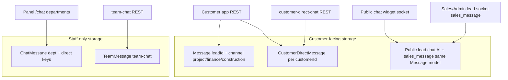

# Customer ↔ staff communication — panel integration guide

**Audience:** Frontend (Admin, Sales, Construction, Plant, Account, Customer app)  
**Problem:** Communication/chat UI appears in multiple panels, but most APIs are **employee-only**. Customers cannot reach sales/admin through those screens. **Lead (pre-sales) chat** exists on the lead record, but **active projects** (post–customer-portal, plant lifecycle) need a clear product + API path.

This doc maps **what exists**, **what is missing**, and **how to wire panels today** vs **what backend should add** for per-project threads.

---

## 1. Executive summary

| Need | Supported today? | Use |
|------|------------------|-----|
| Customer ↔ staff, **one account-wide thread** (any project) | **Yes** | [Customer direct chat](./frontend-customer-direct-chat-api.md) |
| Customer ↔ sales, **pre-sales lead** (AI + assign sales) | **Yes** | [Sales ↔ lead chat](./sales_lead_chat_integration.md) (`/chat` + `/admin` sockets, `Message` without channel focus) |
| Customer ↔ staff, **per active project**, channels `project` / `finance` / `construction` | **Partial** | Customer app **REST only**; **no staff REST**, **no realtime** on customer send |
| Staff ↔ staff (DM, groups, dept rooms) | **Yes** | [Team chat](./internal-communication-socket-guide.md) + panel `/chat` dept routes — **not for customers** |
| Construction/Admin **“Project Team”** dept channel in `/chat` | **Yes (internal only)** | `GET /api/construction/chat/departments/project_team/messages` — **employees only**, not linked to customer `Message.channel=project` |

**Practical recommendation for active projects (until project-channel staff API ships):**

1. **Customer app:** keep using `GET/POST /api/customer/chat/:channel/messages?leadId=` **or** account-wide `/api/customer/chat/direct/*`.
2. **Admin / Sales / Plant / Construction panels:** open chat with **`customerId` from the project row** → `GET/POST /api/{panel}/customer-direct-chat/:customerId/messages` (+ `/admin` socket `join_customer_direct`).  
3. **Do not** point customer-facing UI at `/api/construction/chat/*` or `/api/team-chat/*` — those never reach the customer.

---

## 2. Five separate chat systems (do not mix)



| # | Storage | Scope | Customer can read/write? | Staff panels |
|---|---------|--------|---------------------------|--------------|
| **A** | `Message` + `leadId` + optional **`channel`** | Per **project** (`project`, `finance`, `construction`) | **Write/read** via `/api/customer/chat/...` | **No REST reply API**; socket `sales_message` writes `Message` **without** `channel` (defaults `project`) and targets **lead sales chat**, not finance/construction tabs |
| **B** | `Message` + `leadId` (legacy lead funnel) | Pre-sales **lead** room | Public widget `/chat` + history `GET /api/public/chat/history/:leadId` | Sales/Admin: `join_lead_chat`, `sales_message` on `/admin` — see [socket-chat-reference](./socket-chat-reference.md) |
| **C** | `CustomerDirectMessage` | Per **customer** (all projects share one thread) | `/api/customer/chat/direct/*` | `/api/admin|sales|plant/customer-direct-chat/:customerId/messages` |
| **D** | `ChatMessage` | Dept keys: `project_team`, `finance_team`, … + staff DM | **No** | `/api/admin/chat/*`, mounted as `/api/construction/chat/*` |
| **E** | `TeamMessage` | Staff direct + groups + account dept labels | **No** | `/api/team-chat/*`, account `/api/account/communication/*` |

**Naming trap:** Admin dept channel **`project_team`** is **not** customer channel **`project`**. Different models, different APIs, no sync.

---

## 3. Customer app — per-project channels (system A)

**Base:** `/api/customer` · Customer JWT

| Action | Method | Path |
|--------|--------|------|
| Channels + unread | GET | `/chat/channels?leadId={leadId}` |
| Presence | GET | `/chat/presence?leadId={leadId}` |
| History | GET | `/chat/{channel}/messages?leadId={leadId}&page=1&limit=50` |
| Send | POST | `/chat/{channel}/messages` body `{ "leadId", "content" }` |

`channel` ∈ `project` | `finance` | `construction`.

**Example send**

```http
POST /api/customer/chat/project/messages
Authorization: Bearer {customerToken}
Content-Type: application/json

{
  "leadId": "6ac4e5e6570533c2c601ed40",
  "content": "When is the next delivery?"
}
```

**Example history row**

```json
{
  "_id": "…",
  "leadId": "6ac4…",
  "customerId": "507f…",
  "channel": "project",
  "senderType": "customer",
  "senderName": "Adam",
  "content": "When is the next delivery?",
  "isRead": false,
  "createdAt": "2026-10-08T12:00:00.000Z"
}
```

### Gaps (backend)

1. **No staff REST** to list/reply on `{leadId, channel}` for admin/sales/construction/plant/account.
2. **Customer POST does not emit** socket events to staff (unlike public widget `customer_message` → `processCustomerMessage`).
3. Staff **`sales_message`** (system B) does not set `channel`; finance/construction tabs on the customer app will **never** receive staff replies via socket today.

---

## 4. Customer direct chat (system C) — works end-to-end today

One thread per **customer** (not per `leadId`). Best fit when the same client has multiple active projects but one “talk to MR Storage” inbox.

| Side | REST | Socket |
|------|------|--------|
| Customer | `GET/POST /api/customer/chat/direct/messages` | `/admin` not used on customer; poll or add socket if documented in [direct chat API](./frontend-customer-direct-chat-api.md) |
| Admin | `/api/admin/customer-direct-chat/:customerId/messages` | `/admin` → `join_customer_direct`, `customer_direct_message` |
| Sales | `/api/sales/customer-direct-chat/...` | Same |
| Plant | `/api/plant/customer-direct-chat/...` | Same |

**Open chat from a project row**

```text
GET /api/plant/projects  →  row.customerId
GET /api/plant/customer-direct-chat/{customerId}/messages
POST /api/plant/customer-direct-chat/{customerId}/messages  { "content": "…" }
```

See also: [Plant dashboard + chat handoff](./frontend-plant-dashboard-chat-api.md), [Customer vs plant direct chat confusion](./frontend-customer-app-direct-chat-vs-plant-reply.md).

---

## 5. Lead / pre-sales chat (system B) — not the same as “active project”

Used for **website widget** and **sales lead detail** before or alongside CRM workflow.

| REST | Purpose |
|------|---------|
| `POST /api/public/chat/init` | Create/find customer + lead |
| `GET /api/public/chat/history/:leadId` | Transcript |
| `GET /api/sales/leads/:leadId` | Includes `recentMessages` |
| `GET/PUT …/chat-status`, `…/chat/end`, `…/chat/reopen` | Lifecycle |

| Socket | Event |
|--------|--------|
| Customer `/chat` | `join_lead`, `customer_message` |
| Staff `/admin` | `join_lead_chat`, `sales_message`, `mark_messages_read` |

Room: `lead:{leadId}`.

**Limitation:** Productized for **sales funnel + AI** ([sales_lead_chat_integration](./sales_lead_chat_integration.md)). Construction/plant users should **not** use `sales_message` for operational customer comms; use **direct chat** (section 4). Active PO projects may still have a `leadId`, but panel UX should not assume lead chat is the only thread if the customer uses portal channel tabs.

---

## 6. Panel “Communication” UI — employee-only paths

These power **internal** comms screens duplicated across panels. They **do not** connect to the customer app.

### 6.1 Department + DM (`ChatMessage`)

Mounted at:

- `GET/POST /api/admin/chat/...`
- Same routes under **`/api/construction/chat/...`** (construction JWT)

| GET | Purpose |
|-----|---------|
| `/chat/departments` | `project_team`, `finance_team`, `construction_team`, `plant_team`, `sales_team` |
| `/chat/departments/:channelKey/messages` | Internal team thread |
| `/chat/direct/:userId/messages` | Staff DM (legacy `ChatMessage` direct — separate from team-chat) |

**Auth:** staff JWT only (`admin`, `construction`, etc. per route guard).

### 6.2 Team chat (`TeamMessage`)

- `GET/POST /api/team-chat/direct/:userId/messages`
- `GET/POST /api/team-chat/groups/:groupId/messages`

Guide: [internal-communication-socket-guide.md](./internal-communication-socket-guide.md).

### 6.3 Account panel

- `GET/POST /api/account/communication/channels/...` — staff departments + direct (`TeamMessage`).

---

## 7. Panel matrix — what to implement in UI

| Panel | UI label often says | Wire to (customer) | Wire to (internal only) |
|-------|---------------------|--------------------|-------------------------|
| **Admin** | Chat / Communication | `customer-direct-chat/:customerId` + `/admin` direct socket | `/admin/chat/departments/*`, `/team-chat/*` |
| **Sales** | Lead chat | Lead detail: socket `sales_message` + history; **Active project:** prefer **direct chat** with `customerId` | `/team-chat/*` |
| **Construction** | Project chat | **`customer-direct-chat/:customerId`** from project’s customer | `/construction/chat/departments/*` (internal) |
| **Plant** | Customer chat | **`/plant/customer-direct-chat/:customerId`** (documented) | Do not use lead socket |
| **Account** | Finance comms | **Direct chat** for customer; internal finance dept via account communication | `/account/communication/*` |
| **Customer app** | Project / Finance / Construction tabs | `/customer/chat/:channel/messages?leadId=` | N/A |

---

## 8. Recommended product flows

### Flow 1 — Ship now (minimal backend change)

**Single customer inbox across panels**

1. Customer uses **`/api/customer/chat/direct/*`** *or* project channels knowing staff may only see direct chat today.
2. Every panel “Message customer” button: resolve **`customerId`** from project/lead → **customer-direct-chat** REST + socket.
3. Hide or relabel internal **department chat** so users do not think it messages the client.
4. Sales **lead** screen keeps existing **lead chat** for pre-PO funnel only.

### Flow 2 — Proper per-project + per-channel (backend work)

Add shared staff routes (role guards per panel), e.g.:

```http
GET  /api/sales/projects/:leadId/chat/:channel/messages
POST /api/sales/projects/:leadId/chat/:channel/messages   { "content": "…" }
```

Same handler for `admin`, `construction`, `account` with access rules (assigned sales, construction scope, etc.).

**Backend should also:**

- On customer `POST /api/customer/chat/:channel/messages`, emit to `/admin` room e.g. `lead:{leadId}:channel:{channel}` (or reuse `lead:{leadId}` with `channel` in payload).
- Extend `sales_message` **or** new `staff_project_message` with required `channel`.
- Optional: unify notifications when customer sends on finance/construction channel.

Until then, **Flow 1** is the supported integration.

---

## 9. Quick troubleshooting

| Symptom | Cause |
|---------|--------|
| Customer sends on project tab; staff sees nothing | Staff UI uses **internal** `/chat/departments/project_team` or **team-chat**, not customer `Message` |
| Plant message “works” but not in customer project tab | Plant used **direct chat**; customer views **per-lead channel** — different stores ([direct chat vs plant reply](./frontend-customer-app-direct-chat-vs-plant-reply.md)) |
| Sales replies on lead socket; customer finance tab empty | `sales_message` saves `channel: project` default only |
| Construction chat API 401 for customer | Expected — **employee JWT only** |

---

## 10. Related documentation

| Doc | Topic |
|-----|--------|
| [frontend-customer-direct-chat-api.md](./frontend-customer-direct-chat-api.md) | Customer ↔ admin/sales/plant direct REST + sockets |
| [frontend-customer-app-direct-chat-vs-plant-reply.md](./frontend-customer-app-direct-chat-vs-plant-reply.md) | Wrong API / wrong thread |
| [sales_lead_chat_integration.md](./sales_lead_chat_integration.md) | Widget + sales lead socket |
| [socket-chat-reference.md](./socket-chat-reference.md) | `/chat` + `/admin` lead rooms |
| [internal-communication-socket-guide.md](./internal-communication-socket-guide.md) | Team chat (staff only) |
| [frontend-customer-app-api-full.md](./frontend-customer-app-api-full.md) § 2.11 | Customer project channels |
| [plant-panel-changes-customerid-dashboard-chat-2026-10-08.md](./plant-panel-changes-customerid-dashboard-chat-2026-10-08.md) | Plant `customerId` + direct chat checklist |

---

## 11. Backend checklist (future epic)

- [ ] Staff `GET/POST …/projects/:leadId/chat/:channel/messages` (admin, sales, construction, account, plant with scope)
- [ ] Socket rooms + events for project channel messages (customer REST + staff REST)
- [ ] Mark-read semantics per role/channel
- [ ] Clarify in OpenAPI/Postman: `/chat/departments/*` ≠ customer channels
- [ ] Optional: migrate or bridge lead-only socket chat with portal channel tabs for one transcript UX
