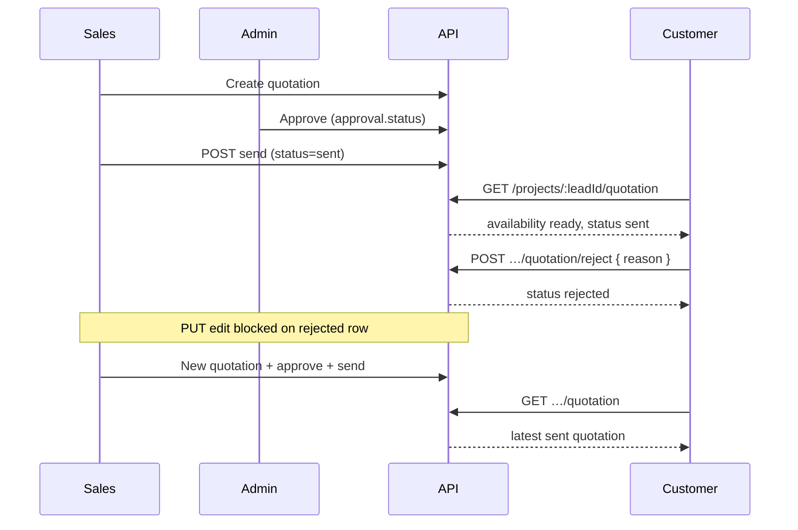

# Customer quotation — reject flow (frontend handoff)

**Audience:** Customer app + Sales/Admin (read-only context)  
**Related:** [`frontend-customer-app-quotation-api.md`](./frontend-customer-app-quotation-api.md) · [`frontend-api-delta-2026-09-10-quotation-approval-versions.md`](./frontend-api-delta-2026-09-10-quotation-approval-versions.md)

**Base:** `{BASE_URL}/api/customer` · Customer JWT from `POST /api/customer/auth/login`

---

## 1. Two different “reject” concepts

Do **not** confuse admin approval reject with customer reject.

| Layer | Field | Who | When |
|--------|--------|-----|------|
| **Admin approval** (internal) | `quotation.approval.status = rejected` | Admin | Before sales may **send** to customer |
| **Customer decision** (portal) | `quotation.status = rejected` | Customer | After quote was **`sent`** to customer |

This document is **customer portal reject** (`quotation.status`).

---

## 2. End-to-end flow (before reject)

```text
Sales creates quotation (often from estimate)
  → approval.status: pending_approval
  → Admin approves → approval.status: approved
  → Sales POST /api/quotations/:id/send
  → quotation.status: sent
Customer GET /api/customer/projects/:leadId/quotation
  → availability: "ready", quotation.status: "sent"
Customer approves OR rejects
```

Sales send / approval APIs: staff only — see quotation approval delta doc above.

---

## 3. Customer reject — API

### Request

```http
POST /api/customer/projects/{leadId}/quotation/reject
Authorization: Bearer {customerAccessToken}
Content-Type: application/json
```

```json
{
  "reason": "Pricing exceeds budget; please revise scope."
}
```

| Field | Required | Notes |
|--------|----------|--------|
| `reason` | No | Saved on quotation **`clientNotes`** |

### Success `200`

```json
{
  "success": true,
  "message": "Success",
  "data": {
    "message": "Quotation rejected",
    "quotation": {
      "_id": "67890abcdef1234567890abc",
      "status": "rejected"
    }
  }
}
```

### Errors

| HTTP | `message` | When |
|------|-----------|------|
| 401 | Unauthorized | Missing/invalid token |
| 403 | This project does not belong to your account | Wrong customer for `leadId` |
| 404 | Project not found | Bad `leadId` |
| 404 | No quotation available to reject | No visible quotation (`sent` / `accepted` / `rejected`) |
| 400 | Quotation is already rejected | Second reject on same quote |

### What the backend does

1. Sets **`quotation.status = "rejected"`**.
2. Sets **`quotation.clientNotes`** from `reason` (if provided).
3. Writes audit log `quotation.rejected` (with reason in metadata).
4. Does **not** change **`approval.status`** (internal admin approval stays as it was, usually `approved`).
5. Creates an in-app notification for the lead’s **assigned sales** (`GET /api/notifications`, `type: quotation`, `refModel: Quotation`).

---

## 4. Customer approve (contrast)

```http
POST /api/customer/projects/{leadId}/quotation/approve
Authorization: Bearer {customerAccessToken}
Content-Type: application/json
```

Body: `{}` or omit.

**Success:** `quotation.status` → **`accepted`**.

| Error | When |
|--------|------|
| 400 Quotation is already accepted | Repeat approve |
| 404 No quotation available to approve | Nothing visible to act on |

Use **approve** only while status is **`sent`**. After **reject**, approve is not the correct action.

---

## 5. Customer UI after reject

### Refresh state

```http
GET /api/customer/projects/{leadId}/quotation
Authorization: Bearer {customerAccessToken}
```

Customer-visible statuses: **`sent`**, **`accepted`**, **`rejected`**.

After reject:

| Field | Expected |
|--------|----------|
| `availability` | **`ready`** (rejected quotes remain visible) |
| `quotation.status` | **`rejected`** |
| `quotation.clientNotes` | Customer reason (if sent on reject) |
| Preview / PDF | Still allowed (`GET …/preview`, `GET …/pdf`) |

### UI checklist

- Show **Rejected** badge when `quotation.status === "rejected"`.
- Hide or disable **Accept** and **Reject** (reject again → 400).
- Optionally show rejection reason from `clientNotes`.
- Message copy: customer must wait for sales to send a **revised** quotation.

---

## 6. Which quotation row the customer sees

Latest quotation for that lead + customer where:

`status ∈ { sent, accepted, rejected }`  
sorted by **`versionNumber` desc**, then **`createdAt` desc**.

When sales sends a **newer** quotation (`status: sent`), **`GET …/quotation`** should return that newer row once it is the latest visible quote.

---

## 7. Sales / admin after customer reject

Staff read same `Quotation` record (not customer routes):

```http
GET /api/quotations/{quotationId}
GET /api/leads/{leadId}/quotations
Authorization: Bearer {staffToken}
```

| Field | After customer reject |
|--------|------------------------|
| `status` | `rejected` |
| `clientNotes` | Customer reason |
| `approval.status` | Usually still `approved` (send gate only) |

Lead **activity / audit** includes customer reject with reason.

---

## 8. How sales publish a revision (important for FE messaging)

After customer reject, **`PUT /api/quotations/:quotationId`** only works when  
`quotation.status` is **`draft`** or **`sent`** — **not** `rejected` or `accepted`.

So sales **cannot edit the rejected document in place**. Typical API path:

1. Sales creates a **new** quotation (or new version workflow on backend)  
   `POST /api/quotations` with `leadId`, etc.
2. Admin **approves** (if sales-created).
3. Sales **`POST /api/quotations/:id/send`** → `status: sent`.
4. Customer **`GET …/quotation`** picks up latest **`sent`** quote.

Updating the linked **estimate** does **not** sync into a **rejected** quotation (`quotation_not_editable`).

**Customer app copy:** “Your sales representative will send an updated quotation.”

---

## 9. Flow diagram



---

## 10. cURL examples (prod)

```bash
# Reject
curl -s -X POST "https://mr-storage-backend-025k.onrender.com/api/customer/projects/LEAD_ID/quotation/reject" \
  -H "Authorization: Bearer CUSTOMER_JWT" \
  -H "Content-Type: application/json" \
  -d '{"reason":"Need revised freight terms"}'

# Refresh
curl -s "https://mr-storage-backend-025k.onrender.com/api/customer/projects/LEAD_ID/quotation" \
  -H "Authorization: Bearer CUSTOMER_JWT"
```

---

## 11. Known gaps (product / backend follow-up)

| Topic | Today |
|--------|--------|
| Notify assigned sales on customer reject | **Yes** — assigned sales inbox |
| Reopen rejected → draft in one API | Not available |
| Single “revise quotation” button for sales | Use new quotation + send flow |

---

## 12. Related customer quotation endpoints

| Action | Method | Path |
|--------|--------|------|
| Metadata + availability | GET | `/projects/:leadId/quotation` |
| HTML preview | GET | `/projects/:leadId/quotation/preview?format=html` |
| PDF | GET | `/projects/:leadId/quotation/pdf` |
| Accept | POST | `/projects/:leadId/quotation/approve` |
| Reject | POST | `/projects/:leadId/quotation/reject` |

Full payloads: [`frontend-customer-app-quotation-api.md`](./frontend-customer-app-quotation-api.md).
