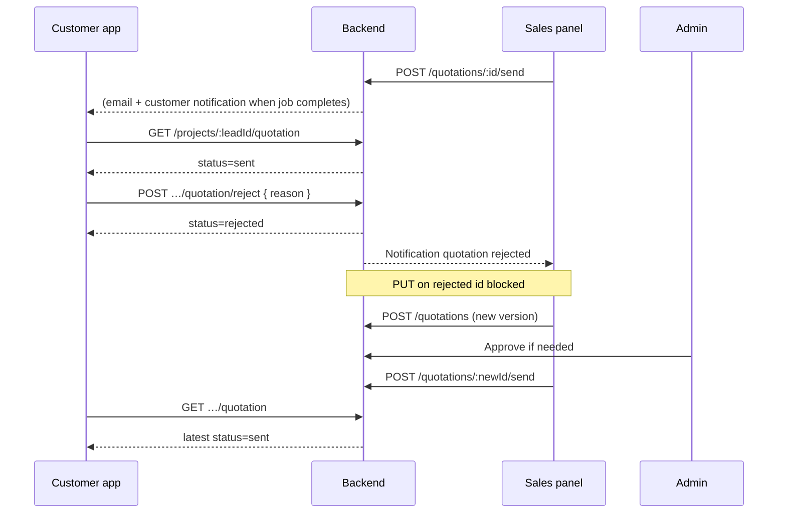
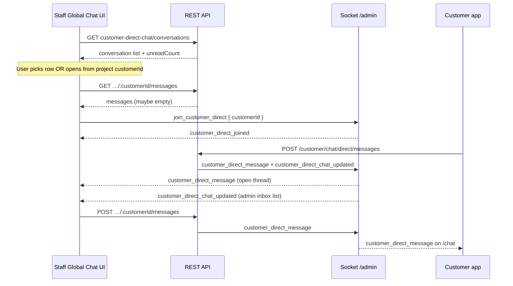

# Flow guide: customer quotation reject + employee ↔ customer chat

**Audience:** Frontend (customer app, sales, admin, plant, construction)  
**Prod API base:** `https://mr-storage-backend-025k.onrender.com/api`  
**Response envelope:** `{ "success": true, "message": "Success", "data": { … } }`

This doc answers two product questions in API terms:

1. **If the customer rejects a quotation, what happens next (step by step)?**
2. **How does employee ↔ customer chat integrate with our current apps?**

---

# Part A — Customer rejects the quotation

## A.1 Do not mix two different “reject” meanings

| Who | What changes | Field |
|-----|----------------|--------|
| **Admin** (internal gate before send) | Admin says quote is not ready to go to customer | `quotation.approval.status = rejected` |
| **Customer** (portal decision) | Customer declines the quote they received | `quotation.status = rejected` |

**This guide is only the customer portal reject** (`quotation.status`).

---

## A.2 Happy path before the customer can reject

The customer can only reject a quote that was **sent** to them.

```text
1. Sales creates quotation (often from estimate)
      → quotation.status: draft
      → quotation.approval.status: pending_approval (if sales-created)

2. Admin approves (staff only)
      → quotation.approval.status: approved

3. Sales sends to customer (staff only)
      POST /api/quotations/{quotationId}/send
      → quotation.status: sent
      → Email job runs; customer may get in-app notification when send completes

4. Customer opens building quotation screen
      GET /api/customer/projects/{leadId}/quotation
      → availability: "ready"
      → quotation.status: "sent"

5. Customer taps Reject (or Accept)
```

---

## A.3 Customer reject — request and response

```http
POST /api/customer/projects/{leadId}/quotation/reject
Authorization: Bearer {customerAccessToken}
Content-Type: application/json
```

**Body**

```json
{
  "reason": "Pricing exceeds budget; please revise freight."
}
```

| Field | Required | Backend effect |
|--------|----------|----------------|
| `reason` | No | Stored on `quotation.clientNotes` |

**Success `200`**

```json
{
  "success": true,
  "message": "Success",
  "data": {
    "message": "Quotation rejected",
    "quotation": {
      "_id": "67890abcdef1234567890abc",
      "status": "rejected"
    }
  }
}
```

**What the API does on reject**

| Step | Action |
|------|--------|
| 1 | Validates customer owns `leadId` |
| 2 | Finds latest customer-visible quotation (`status` ∈ `sent`, `accepted`, `rejected`) |
| 3 | Sets `quotation.status = "rejected"` |
| 4 | Sets `clientNotes` from `reason` if provided |
| 5 | Writes audit log (`quotation.rejected`) |
| 6 | Notifies **assigned sales** on the lead (`GET /api/notifications` — `type: quotation`, `refModel: Quotation`) |

**Errors**

| HTTP | When |
|------|------|
| 401 | Invalid/missing customer token |
| 403 | Project not linked to this customer account |
| 404 | Bad `leadId` or no quotation to reject |
| 400 | Already `rejected` (cannot reject twice) |

---

## A.4 Customer UI after reject

Refresh with the same GET used before approve/reject:

```http
GET /api/customer/projects/{leadId}/quotation
Authorization: Bearer {customerAccessToken}
```

**Expected after reject**

| Field | Value |
|--------|--------|
| `availability` | `ready` (rejected quotes stay visible) |
| `quotation.status` | `rejected` |
| `quotation.clientNotes` | Customer reason |
| Preview / PDF | Still work (`GET …/quotation/preview`, `GET …/quotation/pdf`) |

**UI rules**

- Show **Rejected** badge; disable **Accept** and **Reject**.
- Show `clientNotes` as “Your feedback”.
- Copy: *Sales will send an updated quotation* — customer cannot “undo” reject via API.

**Accept (for comparison)** — only while status is `sent`:

```http
POST /api/customer/projects/{leadId}/quotation/approve
Authorization: Bearer {customerAccessToken}
Content-Type: application/json

{}
```

→ `quotation.status` becomes **`accepted`**; assigned sales gets a **`quotation`** notification.

---

## A.5 Which quotation row the customer sees

Backend picks **one** row per project:

- Same `leadId` + logged-in `customerId`
- `status` ∈ `{ sent, accepted, rejected }`
- Highest `versionNumber`, then newest `createdAt`

When sales sends a **newer** quote with `status: sent`, the next GET should return that newer row (customer sees the revision, not the old rejected one, if the new quote is the latest visible version).

---

## A.6 Sales / admin after customer reject (staff APIs)

Staff **do not** use customer routes. They read the same `Quotation` document:

```http
GET /api/quotations/{quotationId}
GET /api/leads/{leadId}/quotations
Authorization: Bearer {staffToken}
```

| Field | After customer reject |
|--------|------------------------|
| `status` | `rejected` |
| `clientNotes` | Customer reason |
| `approval.status` | Usually still `approved` (that gate was for *sending*, not customer decision) |

Sales can also see **`GET /api/notifications`** with title like “Quotation rejected” and reason in `body`.

---

## A.7 How sales publishes a revision (critical for messaging)

After customer reject, **`PUT /api/quotations/{id}` only works when `status` is `draft` or `sent`**.

A **`rejected`** quotation **cannot be edited in place**.

**Supported revision flow (API)**

```text
Customer rejected quote v3 (status=rejected, clientNotes=reason)
    ↓
Sales creates NEW quotation (new version / new POST)
    POST /api/quotations  { leadId, … }
    ↓
Admin approves if required
    ↓
Sales sends again
    POST /api/quotations/{newId}/send  → status=sent
    ↓
Customer GET /api/customer/projects/{leadId}/quotation
    → latest sent quote (e.g. v4)
```

Updating the **estimate** alone does **not** update a rejected quotation document.

---

## A.8 Sequence diagram — reject + revision



---

## A.9 Endpoint cheat sheet (customer quotation)

| Action | Method | Path |
|--------|--------|------|
| Load screen | GET | `/api/customer/projects/:leadId/quotation` |
| HTML preview | GET | `/api/customer/projects/:leadId/quotation/preview?format=html` |
| PDF | GET | `/api/customer/projects/:leadId/quotation/pdf` |
| Accept | POST | `/api/customer/projects/:leadId/quotation/approve` |
| Reject | POST | `/api/customer/projects/:leadId/quotation/reject` |

More payloads: [`frontend-customer-app-quotation-api.md`](./frontend-customer-app-quotation-api.md) · reject detail: [`frontend-customer-quotation-reject-flow-api.md`](./frontend-customer-quotation-reject-flow-api.md)

---

# Part B — Employee ↔ customer chat

## B.1 The core problem

Many staff panels show a **“Chat”** or **“Communication”** screen. Those screens often call **employee-only** APIs (team chat, department rooms). Those threads **never reach the customer app**.

For **talking to the customer**, you must use one of the **customer-facing** systems below — not `/api/construction/chat/departments/*` or `/api/team-chat/*`.

---

## B.2 Two ways customers can chat (pick product UX deliberately)

| Mode | Customer API | Staff API | Same thread? | Realtime today |
|------|----------------|-----------|--------------|----------------|
| **A. Account-wide direct chat** (recommended for staff reply) | `/api/customer/chat/direct/*` | `/api/{admin\|sales\|plant}/customer-direct-chat/:customerId/*` | **Yes** — one inbox per customer | **Yes** — sockets on `/chat` (customer) and `/admin` (staff) |
| **B. Per-project channels** | `/api/customer/chat/{channel}/messages?leadId=` | **No staff REST yet** for `{leadId, channel}` | Customer tabs only | Customer send → staff **notification** to assigned sales; **no** socket to staff project channel |

**Channels (mode B):** `project` | `finance` | `construction`

```http
POST /api/customer/chat/project/messages
Authorization: Bearer {customerToken}
Content-Type: application/json

{
  "leadId": "6ac4e5e6570533c2c601ed40",
  "content": "When is the next delivery?"
}
```

**History**

```http
GET /api/customer/chat/project/messages?leadId=6ac4e5e6570533c2c601ed40&page=1&limit=50
Authorization: Bearer {customerToken}
```

**Example message (mode B — `Message` model)**

```json
{
  "_id": "66f…",
  "leadId": "6ac4e5e6570533c2c601ed40",
  "channel": "project",
  "senderType": "customer",
  "senderName": "Adam",
  "content": "When is the next delivery?",
  "isRead": false,
  "createdAt": "2026-10-08T12:00:00.000Z"
}
```

On customer send (mode B), **assigned sales** receives **`GET /api/notifications`** (`type: chat`, `refModel: Message`). Staff still need a **future REST** or must use **direct chat** to reply.

---

## B.3 Direct chat — end-to-end flow (mode A)

**One thread per customer** (`CustomerDirectMessage`). All projects share this inbox. Plant, sales, and admin use the **same** staff routes pattern with different base path.

### Customer app

| Action | Method | Path |
|--------|--------|------|
| Summary (badge) | GET | `/api/customer/chat/direct` |
| History | GET | `/api/customer/chat/direct/messages?page=1&limit=50` |
| Send | POST | `/api/customer/chat/direct/messages` body `{ "content": "…" }` |

**Send example response `201`**

```json
{
  "success": true,
  "data": {
    "message": {
      "messageId": "68f…",
      "customerId": "67a…",
      "senderType": "customer",
      "senderName": "Adam",
      "content": "Hello",
      "isReadByCustomer": true,
      "isReadByStaff": false,
      "createdAt": "2026-10-09T12:00:00.000Z"
    }
  }
}
```

### Staff (from a project row)

1. Load project → read **`customerId`** from lead/project payload (not `leadId` for direct chat URL).
2. Open thread:

```http
GET /api/plant/customer-direct-chat/{customerId}/messages?page=1&limit=50
Authorization: Bearer {plantToken}
```

3. Reply:

```http
POST /api/plant/customer-direct-chat/{customerId}/messages
Authorization: Bearer {plantToken}
Content-Type: application/json

{ "content": "Your drawings are approved." }
```

Same pattern for:

- `/api/admin/customer-direct-chat/{customerId}/messages`
- `/api/sales/customer-direct-chat/{customerId}/messages`

**Staff inbox (all customers with activity)**

```http
GET /api/admin/customer-direct-chat/conversations?search=adam&page=1&limit=20
Authorization: Bearer {adminToken}
```

### Realtime (direct chat)

| Role | Socket namespace | Join | Listen |
|------|------------------|------|--------|
| Customer | `/chat` | `join_customer_direct` (no customerId in body — from JWT) | `customer_direct_message` |
| Staff (**admin**, **sales** only for socket join) | `/admin` | `join_customer_direct` with `{ customerId }` | `customer_direct_message` |
| Staff (**plant**, etc.) | REST only today | `POST/GET …/customer-direct-chat/...` works; socket `join_customer_direct` returns **Not allowed** | Poll thread REST or extend backend roles |

**Integration rule:** On customer app chat screen, **load history via REST**, then **join socket** for live updates. Any staff **POST** still delivers to the customer via `/chat` room.

Full socket detail: [`frontend-customer-direct-chat-api.md`](./frontend-customer-direct-chat-api.md) · [`frontend-customer-app-direct-chat-vs-plant-reply.md`](./frontend-customer-app-direct-chat-vs-plant-reply.md)

---

## B.4 How this fits “our current flow” by panel

```mermaid
flowchart LR
  subgraph customerApp [Customer app]
    D[Direct inbox /api/customer/chat/direct]
    P[Project tabs project/finance/construction]
  end
  subgraph staff [Staff panels]
    DC[customer-direct-chat / customerId]
    LC[Lead socket sales_message pre-sales]
    INT[Internal dept chat NOT customer]
  end
  D <-->|CustomerDirectMessage| DC
  P -->|Message only customer side| N[Sales notification]
  LC -.->|Pre-sales lead only| Widget[Public widget / sales lead]
  INT x-.x customerApp
```

| Panel / screen | Wire customer chat to | Do NOT use for customer |
|----------------|------------------------|-------------------------|
| **Customer app** — “Messages” / support | **Direct chat** and/or project channel tabs (know staff may only answer via direct today) | — |
| **Sales** — active project | `customer-direct-chat/:customerId` | Internal team-chat only |
| **Sales** — pre-sales lead | Lead socket `sales_message` + `GET /api/sales/leads/:leadId` | Confuse with direct chat storage |
| **Plant / Admin / Sales** — “Message customer” | `…/customer-direct-chat/:customerId` | `/construction/chat/departments/project_team` |
| **Construction** — “Message customer” | **No `/api/construction/customer-direct-chat` yet** — use **sales/admin/plant** direct chat with project’s `customerId`, or add route later | Internal construction `/chat` only |
| **Any panel** — “Team communication” | Internal APIs only | Never expect customer to see these |

---

## B.5 Common bug: Plant sent message, customer does not see it

| Plant used | Customer app loads | Result |
|------------|-------------------|--------|
| `POST /api/plant/customer-direct-chat/:customerId/messages` | `GET /api/customer/chat/direct/messages` | **Works** |
| Same Plant POST | `GET /api/customer/chat/project/messages?leadId=…` | **Empty / wrong thread** |

`:customerId` in the URL must match the logged-in customer’s `_id`.

---

## B.6 Pre-sales lead chat (third system — not the same as portal project tabs)

Used for **website widget** and **sales lead detail** before/during early funnel:

| | |
|--|--|
| REST | `GET /api/public/chat/history/:leadId`, sales lead endpoints |
| Socket | Customer `/chat` → `join_lead`, `customer_message`; Staff `/admin` → `join_lead_chat`, `sales_message` |

Room: `lead:{leadId}`. Messages live in **`Message`** but **without** the same channel semantics as customer portal `finance` / `construction` tabs.

**For active PO / construction lifecycle:** prefer **direct chat (B.3)** or wait for staff project-channel API; do not assume `sales_message` fills customer **finance** tab.

---

## B.7 Recommended integration (ship now)

**Option 1 — Single customer inbox (simplest)**

1. Customer app: primary UI = **`/api/customer/chat/direct/*`** (+ socket).
2. Every staff “Chat with customer” button: resolve **`customerId`** → **customer-direct-chat** REST + `/admin` socket.
3. Optionally keep project/finance/construction tabs as **categories** in UI but copy explains replies come in main inbox — or hide tabs until staff channel API exists.

**Option 2 — Keep project tabs on customer app**

1. Customer sends on **`/chat/:channel/messages`**.
2. Staff must monitor **`/api/notifications`** (`type: chat`) or sales opens **direct chat** with that customer to reply (reply will **not** appear in the same `Message` channel thread until backend adds staff `POST …/projects/:leadId/chat/:channel/messages`).

---

## B.8 Staff notifications (chat + quotation)

```http
GET /api/notifications?page=1&limit=20&type=chat
GET /api/notifications/unread-count
Authorization: Bearer {staffToken}
```

Use `refModel` + `refId` + `leadId` to deep-link (quotation detail, open direct chat with customer from project, etc.).

Customer notifications (quotation ready, etc.):

```http
GET /api/customer/notifications
Authorization: Bearer {customerToken}
```

---

## B.9 Global chats — browse, initiate, and live updates (what “sir” meant)

There is **no single API** named “global chat”. The **Global / Communication** screen in Figma is a **frontend screen** that should combine a few backends. This section is the step-by-step wiring.

### B.9.1 What “global chats” should show (recommended product split)

| Section in UI | Data source | Reaches customer? |
|---------------|-------------|-------------------|
| **Customers** (or “Client messages”) | `GET /api/{panel}/customer-direct-chat/conversations` | **Yes** |
| **Team** (internal) | `GET /api/team-chat/conversations` | **No** — staff only |
| **Alerts** (optional strip) | `GET /api/notifications?type=chat` | Deep-link to customer thread |

Do **not** put `/api/admin/chat/departments/project_team` messages in the **customer** section — that is internal staff chat.

**Panels that have customer-direct-chat today:** `admin`, `sales`, `plant` (same routes, different prefix):

```text
/api/admin/customer-direct-chat/...
/api/sales/customer-direct-chat/...
/api/plant/customer-direct-chat/...
```

---

### B.9.2 Browse — list existing customer threads

**When:** User opens Global Chat / Communication → **Customers** tab.

```http
GET /api/sales/customer-direct-chat/conversations?search=adam&page=1&limit=20
Authorization: Bearer {staffToken}
```

(Replace prefix with `admin` or `plant` for that app.)

**Response `200`**

```json
{
  "success": true,
  "data": {
    "conversations": [
      {
        "customerId": "67a1b2c3d4e5f6789012345",
        "customerName": "Adam Gilchrist",
        "email": "adam@example.com",
        "company": "Gilchrist Co",
        "unreadCount": 2,
        "lastMessage": "When is delivery?",
        "lastMessageAt": "2026-10-09T14:00:00.000Z",
        "lastSenderType": "customer"
      }
    ],
    "total": 1,
    "page": 1,
    "limit": 20
  }
}
```

**UI behaviour**

- Sort is already **most recent `lastMessageAt` first** (backend).
- **`unreadCount`** = customer messages staff has not opened (thread not loaded with GET messages since send).
- **`search`** matches customer name, email, company — only customers who **already have at least one direct message** appear (empty threads are not listed here).

**Refresh strategy for the list**

| Role | Live inbox bump |
|------|------------------|
| **Admin** | On connect to `/admin`, socket auto-joins `admin_room`. Listen **`customer_direct_chat_updated`** → re-fetch conversations or patch one row. |
| **Sales** | **Not** in `admin_room` today → re-fetch `GET …/conversations` on timer (e.g. 30s), app focus, or when **`GET /api/notifications/unread-count`** increases. |
| **Plant** | Same as sales (REST + optional poll); socket join for direct chat is **admin/sales only** today. |

**`customer_direct_chat_updated` payload (admin inbox hint)**

Emitted on every direct message (customer or staff send). Example fields:

```json
{
  "customerId": "67a1b2c3d4e5f6789012345",
  "messageId": "68f…",
  "content": "…",
  "senderType": "customer",
  "createdAt": "2026-10-09T14:00:00.000Z"
}
```

Use it to update the sidebar preview without reloading the open thread (if that customer is not the active chat).

---

### B.9.3 Initiate — start chat with a customer (including first message ever)

The conversations list **only shows customers who already have messages**. To **start** a chat from a **project** or **lead**:

```text
1. Open project / lead detail (any panel).
2. Read customerId from API (e.g. plant project row, sales lead, construction project detail).
3. Navigate to chat screen with that customerId.
4. GET thread (may be empty).
5. POST first message → thread exists; next GET conversations includes this customer.
```

**Step 4 — load thread (even if empty)**

```http
GET /api/plant/customer-direct-chat/67a1b2c3d4e5f6789012345/messages?page=1&limit=50
Authorization: Bearer {staffToken}
```

**Response when never messaged before**

```json
{
  "success": true,
  "data": {
    "customer": {
      "_id": "67a1b2c3d4e5f6789012345",
      "firstName": "Adam",
      "lastName": "Gilchrist",
      "email": "adam@example.com"
    },
    "messages": [],
    "total": 0,
    "page": 1,
    "limit": 50
  }
}
```

**Step 5 — first message (initiate)**

```http
POST /api/plant/customer-direct-chat/67a1b2c3d4e5f6789012345/messages
Authorization: Bearer {staffToken}
Content-Type: application/json

{ "content": "Hi Adam, your load ships Friday." }
```

Customer sees it in **`GET /api/customer/chat/direct/messages`** (and on socket if app joined `join_customer_direct`).

**Initiate from Global Chat UI without a project**

- Provide **customer search** via your existing **customers/leads** APIs, then use the same **`customerId`** in GET/POST direct chat URLs.
- There is no “create empty conversation” endpoint — **first POST** creates the thread.

---

### B.9.4 Open thread — live messages while chat is on screen

**Staff (admin / sales) — recommended sequence**

```javascript
// 1) REST history
const { data } = await GET(`/api/sales/customer-direct-chat/${customerId}/messages?page=1&limit=50`)

// 2) Socket (staff JWT on /admin namespace)
const socket = io(WS_ORIGIN + '/admin', { auth: { token: staffJwt } })

socket.emit('join_customer_direct', { customerId })

socket.on('customer_direct_joined', () => { /* subscribed */ })

socket.on('customer_direct_message', (msg) => {
  // append if msg.customerId === active customerId
})

// 3) Send (REST or socket)
await POST(`/api/sales/customer-direct-chat/${customerId}/messages`, { content: '…' })
// OR socket.emit('customer_direct_message', { customerId, content: '…' })
```

**Customer app — same pattern**

```javascript
await GET('/api/customer/chat/direct/messages?page=1&limit=50')

const socket = io(WS_ORIGIN + '/chat', { auth: { token: customerJwt } })
socket.emit('join_customer_direct', {})  // customerId from token

socket.on('customer_direct_message', appendMessage)
```

---

### B.9.5 Project channel messages vs global customer inbox

If the customer uses **Project / Finance / Construction** tabs (`POST /api/customer/chat/project/messages`, etc.):

| What happens | Where staff sees it |
|--------------|---------------------|
| Message stored in **`Message`** with `leadId` + `channel` | **Not** in `customer-direct-chat/conversations` |
| Assigned sales gets **`GET /api/notifications`** (`type: chat`, `leadId`, `refModel: Message`) | Notification bell / global alerts |
| Customer does **not** see staff reply on that tab | Staff must reply via **direct chat** (same `customerId`) until project-channel staff API exists |

**Recommended FE flow when sales taps a “new customer message” notification**

```text
Notification (leadId, refModel Message)
  → Load lead/project → customerId
  → Open GET/POST /api/sales/customer-direct-chat/:customerId/messages
  → Reply in direct chat (customer sees it in main Messages inbox)
```

---

### B.9.6 End-to-end diagram — global Communication screen



---

### B.9.7 Customer app “global chat” (mirror behaviour)

| Step | API |
|------|-----|
| Badge / last preview | `GET /api/customer/chat/direct` |
| Open inbox | `GET /api/customer/chat/direct/messages` |
| Live updates | `/chat` socket `join_customer_direct` + `customer_direct_message` |
| Global notifications (drawings, quotation, etc.) | `GET /api/customer/notifications` — **separate** from chat thread |

If the product wants **one** “Global” hub on customer app: merge **direct chat summary** + **notifications** in the UI; backend stays two APIs.

---

### B.9.8 Backend gaps (so FE expectations match reality)

| Gap | Workaround for FE |
|-----|-------------------|
| Construction has no `customer-direct-chat` mount | Open chat via sales/admin/plant app or share `customerId` into sales direct chat |
| Sales/plant not in `admin_room` | Poll `conversations` or use notifications |
| Plant socket `join_customer_direct` blocked | Poll `GET …/messages` while thread open |
| Customer project tabs ≠ direct thread | Route staff replies through direct chat; use notifications to discover project-tab sends |

---

## B.10 Related docs

| Topic | Doc |
|--------|-----|
| Full communication map | [`frontend-customer-project-communication-integration.md`](./frontend-customer-project-communication-integration.md) |
| Direct chat REST + sockets | [`frontend-customer-direct-chat-api.md`](./frontend-customer-direct-chat-api.md) |
| Plant vs customer wrong API | [`frontend-customer-app-direct-chat-vs-plant-reply.md`](./frontend-customer-app-direct-chat-vs-plant-reply.md) |
| Integration index | [`frontend-integration-handoff-2026-10.md`](./frontend-integration-handoff-2026-10.md) |

**Browse / initiate / global inbox:** see **§ B.9** above.  
**UI wireframes (staff Customers vs Team vs customer app):** [`frontend-global-chat-ui-staff-and-customer.md`](./frontend-global-chat-ui-staff-and-customer.md)
