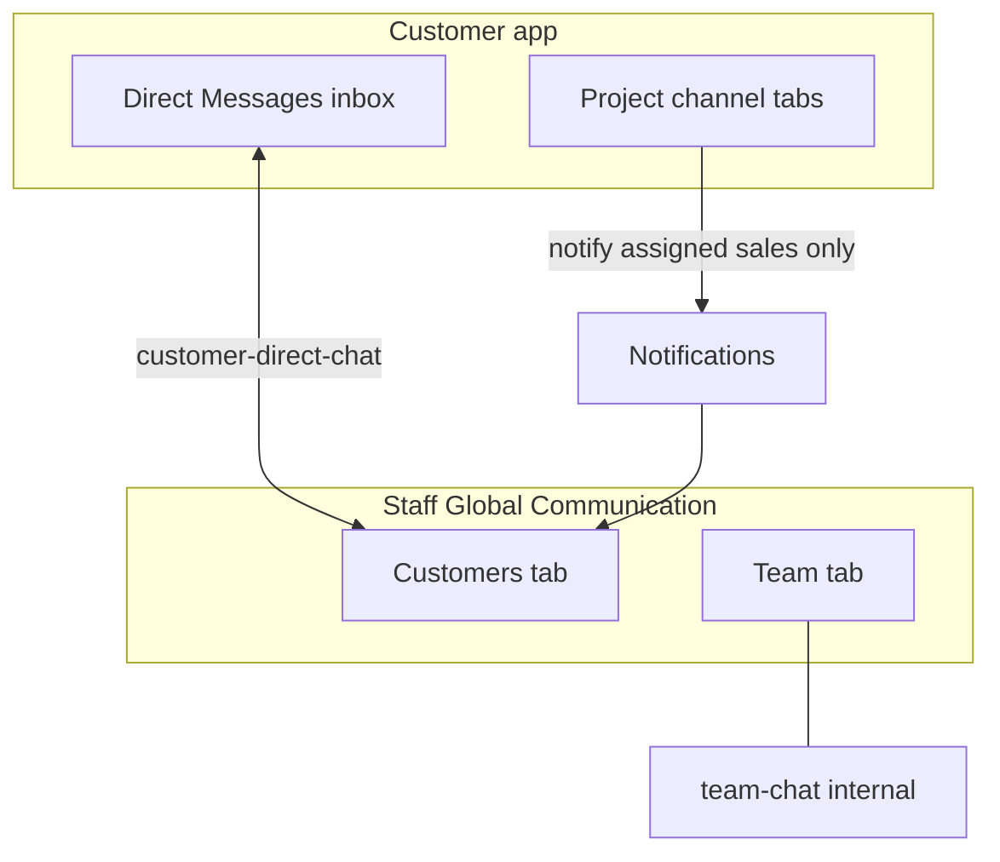

# Global chat UI — staff panels vs customer app

**Audience:** Frontend (all employee panels + customer mobile/web)  
**Goal:** Same **UX pattern** as Teams internal chat (list → thread → send), but **two different backends** for staff; customer app has **two chat surfaces** you should not mix up.

**Related:** [`frontend-flow-quotation-reject-and-employee-customer-chat.md`](./frontend-flow-quotation-reject-and-employee-customer-chat.md) § B.9 · [`frontend-customer-direct-chat-api.md`](./frontend-customer-direct-chat-api.md)

---

## 1. One screen, two lists (employee “Global Communication”)

Think **Microsoft Teams**: left sidebar = conversations, right = active thread. On staff apps, build **two tabs** (or filters), not one merged API.

```text
┌─────────────────────────────────────────────────────────────┐
│  Global Communication                                        │
├──────────────┬──────────────────────────────────────────────┤
│ [Customers]  │  Thread header: Adam Gilchrist               │
│ [Team]       │  ─────────────────────────────────────────── │
│              │  Adam: When is delivery?          10:02 AM   │
│  Customers:  │  You:  Load ships Friday.         10:05 AM   │
│  ● Adam  (2) │                                              │
│    Jane  (0) │  [ Type message… ]              [ Send ]     │
│              │                                              │
│  Team:       │                                              │
│  ● Mike      │                                              │
│    #Finance  │                                              │
└──────────────┴──────────────────────────────────────────────┘
```

| Tab | Feels like Teams… | API | Talks to customer? |
|-----|-------------------|-----|--------------------|
| **Customers** | Chat with **external** contact | `customer-direct-chat` | **Yes** |
| **Team** | Chat with **coworkers** | `team-chat` | **No** |

Internal **department** chat (`/api/admin/chat/departments/project_team`, etc.) is a **third** system — keep it under Team/settings or a separate “Internal rooms” area, **not** under Customers.

---

## 2. Staff — browse & initiate (Customers tab)

This is the parallel to **`GET /api/team-chat/conversations`**, but for **customers**.

### 2.1 Browse (sidebar list)

Same UX as team chat inbox: search, unread badge, last message preview, sorted by recent activity.

```http
GET /api/sales/customer-direct-chat/conversations?search=adam&page=1&limit=20
Authorization: Bearer {staffToken}
```

Use prefix for the app:

| Panel | Base path |
|-------|-----------|
| Admin | `/api/admin/customer-direct-chat` |
| Sales | `/api/sales/customer-direct-chat` |
| Plant | `/api/plant/customer-direct-chat` |

**Row → UI mapping**

| API field | Render as |
|-----------|-----------|
| `customerName` / `email` | Title + subtitle |
| `lastMessage` | Preview line |
| `lastMessageAt` | Time |
| `unreadCount` | Badge on row |
| `lastSenderType` | Optional “You:” vs name prefix |

**Important:** List only includes customers who **already have** at least one **direct** message. Empty threads do not appear until the first send.

### 2.2 Initiate (no row in list yet)

Same UX as opening a **new Teams chat** by picking a person — but you pick a **customer** from a **project** (or customer directory), not from `conversations`.

```text
Project detail  →  customerId on payload
       ↓
Navigate to chat with customerId
       ↓
GET …/customer-direct-chat/{customerId}/messages   →  messages may be []
       ↓
POST …/customer-direct-chat/{customerId}/messages  →  first line creates thread
       ↓
Next GET …/conversations includes this customer
```

**From project (example plant project row)**

```json
{
  "leadId": "6ac4e5e6570533c2c601ed40",
  "projectName": "Adam Warehouse",
  "customerId": "67a1b2c3d4e5f6789012345"
}
```

Button **“Message customer”** → open thread with `67a1b2c3d4e5f6789012345` (use **`customerId`**, not `leadId`, in the URL).

**Open / load thread**

```http
GET /api/plant/customer-direct-chat/67a1b2c3d4e5f6789012345/messages?page=1&limit=50
```

**Send (including first message ever)**

```http
POST /api/plant/customer-direct-chat/67a1b2c3d4e5f6789012345/messages
Content-Type: application/json

{ "content": "Hi Adam, your drawings are approved." }
```

**Message bubble (staff thread)**

```json
{
  "messageId": "68f…",
  "customerId": "67a1…",
  "senderType": "customer",
  "senderId": null,
  "senderName": "Adam Gilchrist",
  "content": "When is delivery?",
  "isReadByCustomer": true,
  "isReadByStaff": false,
  "createdAt": "2026-10-09T14:00:00.000Z"
}
```

| `senderType` | Bubble side | Name label |
|--------------|-------------|------------|
| `customer` | Left (incoming) | `senderName` |
| `sales` | Right (outgoing) | You / staff name |
| `admin` | Right (outgoing) | Plant/construction staff show as **`admin`** in API |

### 2.3 Live updates (Customers tab)

| Event | When |
|--------|------|
| **`customer_direct_message`** | Open thread; admin/sales on `/admin` after `join_customer_direct { customerId }` |
| **`customer_direct_chat_updated`** | **Admin only** (in `admin_room`) — refresh sidebar row |
| Poll `GET …/conversations` | Sales / plant sidebar if no socket |

---

## 3. Staff — browse & initiate (Team tab = internal, like Teams)

This is **only employees**. Customer never sees these messages.

### 3.1 Browse

```http
GET /api/team-chat/conversations
Authorization: Bearer {staffToken}
```

**Response shape (mixed list)**

```json
{
  "success": true,
  "data": {
    "conversations": [
      {
        "type": "direct",
        "userId": "64abc…",
        "name": "Mike Chen",
        "email": "mike@mrstorage.com",
        "role": "sales",
        "lastMessage": "Can you review the BOM?",
        "lastMessageAt": "2026-10-09T11:00:00.000Z",
        "unreadCount": 1
      },
      {
        "type": "group",
        "groupId": "66group…",
        "name": "Finance team",
        "memberCount": 8,
        "lastMessage": "Invoice batch sent",
        "lastMessageAt": "2026-10-08T16:00:00.000Z",
        "unreadCount": 0
      }
    ]
  }
}
```

Render **`type: direct`** vs **`type: group`** like Teams 1:1 vs group chat.

### 3.2 Open thread

| Type | History API |
|------|-------------|
| Direct | `GET /api/team-chat/direct/{userId}/messages` |
| Group | `GET /api/team-chat/groups/{groupId}/messages` |

Send: corresponding `POST` on the same paths.

Unread total (app bar badge for **team only**):

```http
GET /api/team-chat/unread-count
```

---

## 4. Side-by-side — staff “browse + initiate”

| Step | **Customers tab** (with client) | **Team tab** (internal) |
|------|----------------------------------|-------------------------|
| List conversations | `GET …/customer-direct-chat/conversations` | `GET /api/team-chat/conversations` |
| Search | `?search=` on conversations | Filter client-side or user search API |
| Pick row | Use `customerId` | Use `userId` or `groupId` |
| Start without row | Project → `customerId` → GET/POST direct | Pick colleague → POST first team message |
| Thread key | **`customerId`** | **`userId`** or **`groupId`** |
| Customer sees it? | Yes, in customer **Direct** inbox | No |

---

## 5. Customer app — how chat should look

The customer has **two different chat UIs** in the API. Product should choose **one primary** inbox (recommended: **Direct**) and treat project tabs as optional or secondary.

### 5.1 Recommended: one “Messages” inbox (Direct chat)

**Same idea as staff Customers tab**, but single thread per account (all projects share one line to MR Storage).

```text
┌─────────────────────────────────────┐
│  Messages                    (2)    │
├─────────────────────────────────────┤
│  MR Storage                         │
│  Plant: Your load ships Friday.     │
│                          Yesterday  │
├─────────────────────────────────────┤
│  [ Thread — all staff in one line ] │
│                                     │
│  You: When is delivery?      10:02  │
│  Plant User: Friday.         10:05  │
│                                     │
│  [ Type message… ]        [ Send ]  │
└─────────────────────────────────────┘
```

| Step | API |
|------|-----|
| Inbox summary / badge | `GET /api/customer/chat/direct` |
| Load thread | `GET /api/customer/chat/direct/messages?page=1&limit=50` |
| Send | `POST /api/customer/chat/direct/messages` `{ "content": "…" }` |
| Live | Socket `/chat` → `join_customer_direct` → listen `customer_direct_message` |

**Summary response**

```json
{
  "success": true,
  "data": {
    "customerId": "67a1…",
    "unreadCount": 2,
    "lastMessage": {
      "messageId": "68f…",
      "senderType": "admin",
      "senderName": "Plant User",
      "content": "Your load ships Friday.",
      "createdAt": "2026-10-09T10:05:00.000Z"
    }
  }
}
```

**What the customer sees when plant/sales/admin replies**

- Staff use **`customer-direct-chat`** → customer sees it here (**not** under project tabs).
- `senderType`: `admin` | `sales` | `customer` — show label “MR Storage”, “Sales”, or customer name.

---

### 5.2 Optional: per-project channel tabs (Figma “Project / Finance / Construction”)

Inside **one project**, three tabs — each is a **separate** thread on the backend (`Message` model).

```http
GET /api/customer/chat/channels?leadId=6ac4e5e6570533c2c601ed40
```

**Response**

```json
{
  "success": true,
  "data": {
    "channels": [
      { "key": "project", "label": "Project Team", "unreadCount": 0 },
      { "key": "finance", "label": "Finance Team", "unreadCount": 1 },
      { "key": "construction", "label": "Construction Team", "unreadCount": 0 }
    ]
  }
}
```

**UI sketch**

```text
Project: Adam Warehouse
[ Project Team ] [ Finance Team ] [ Construction Team ]
─────────────────────────────────────────────────────
  You: Question about invoice        9:00 AM
  (no staff reply in this tab yet — staff may reply in Direct inbox only)
─────────────────────────────────────────────────────
[ Type message… ]
```

**Per tab**

```http
GET /api/customer/chat/project/messages?leadId=6ac4e5e6570533c2c601ed40&page=1&limit=50
POST /api/customer/chat/project/messages
{ "leadId": "6ac4…", "content": "…" }
```

(`project` → `finance` | `construction` in path.)

**Message shape (project channels)**

```json
{
  "_id": "68f…",
  "leadId": "6ac4…",
  "channel": "finance",
  "senderType": "customer",
  "senderName": "Adam",
  "content": "When is the next payment due?",
  "isRead": false,
  "createdAt": "2026-10-08T12:00:00.000Z"
}
```

Note: docs/examples may show `senderType: "staff"` for inbound staff messages on this model when staff API exists; today **customer sends** here; **staff replies** should go through **direct chat** unless you add staff channel APIs.

**Presence (optional “online” dots)**

```http
GET /api/customer/chat/presence?leadId=6ac4e5e6570533c2c601ed40
```

```json
{
  "leadId": "6ac4…",
  "customerIsOnline": true,
  "staffIsOnline": false
}
```

---

## 6. Customer vs staff — what matches what



| Customer UI | Staff UI that pairs with it |
|-------------|-----------------------------|
| **Direct Messages** (`/chat/direct/*`) | **Customers** tab (`customer-direct-chat`) |
| **Project / Finance / Construction tabs** | No dedicated inbox row — **notifications** → open **Customers** tab with same `customerId` |
| — | **Team** tab — internal only; customer never sees |

---

## 7. Product recommendation (avoid confusion)

1. **Customer app:** Make **Messages** = `GET/POST /api/customer/chat/direct/*` (single thread). Optionally hide or de-emphasize project channel tabs until staff can reply in-channel.
2. **Staff panels:** **Global Communication** = **Customers** (`customer-direct-chat`) + **Team** (`team-chat`), same layout pattern.
3. **“Message customer” on any project:** Always resolve **`customerId`** → open **Customers** thread (browse/initiate flow in §2).
4. **Do not** expect customer project-tab messages to appear in staff **Team** tab or **department** chat.

---

## 8. Construction panel note

There is no `/api/construction/customer-direct-chat` mount yet. Construction users should either use another role’s direct chat with the project’s `customerId` or wait for a construction mount — UX pattern is identical once the route exists.

---

## 9. Quick API index

### Staff — customers (external)

- `GET …/customer-direct-chat/conversations`
- `GET …/customer-direct-chat/:customerId/messages`
- `POST …/customer-direct-chat/:customerId/messages`

### Staff — team (internal)

- `GET /api/team-chat/conversations`
- `GET|POST /api/team-chat/direct/:userId/messages`
- `GET|POST /api/team-chat/groups/:groupId/messages`

### Customer

- `GET /api/customer/chat/direct`
- `GET|POST /api/customer/chat/direct/messages`
- `GET /api/customer/chat/channels?leadId=`
- `GET|POST /api/customer/chat/:channel/messages?leadId=`

All customer paths prefixed with `/api/customer` and customer JWT.
