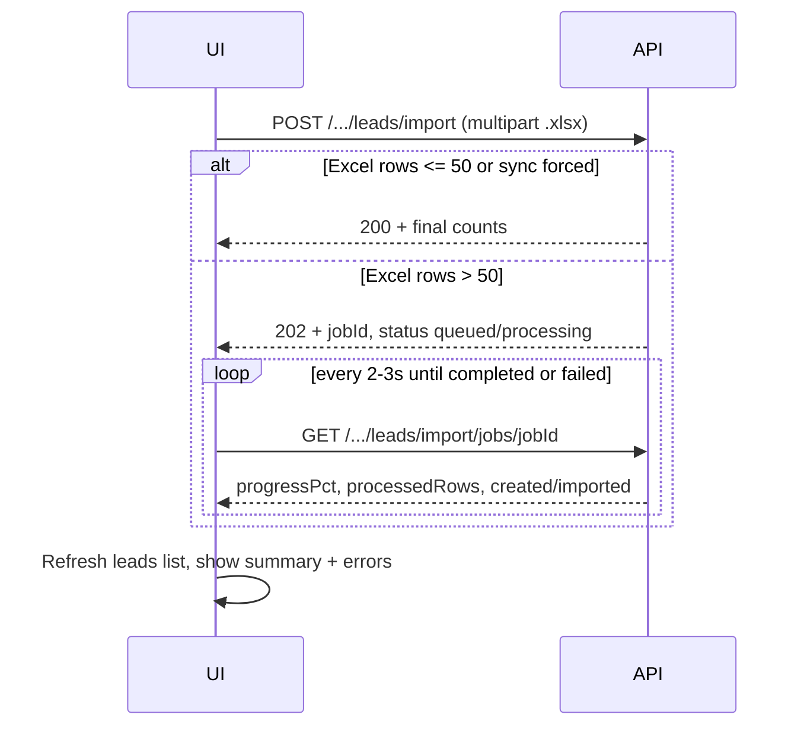

# Frontend handoff — Bulk lead import (Excel + job status)

Use this doc to wire **Admin** and **Sales** “Import leads” to the backend. Supports **TractIQ-style `.xlsx`** (e.g. *Storage Project Leads* export) and legacy **CSV text**.

---

## Base URL & auth

| Environment | API base (examples) |
|-------------|---------------------|
| UAT | `https://uat.flyweistechnology.com/api` |
| Production | `https://flyweistechnology.com/api` (or your deployed API origin) |

Every request:

```http
Authorization: Bearer <staffAccessToken>
```

**Roles:** `admin` or `sales` (each panel uses its own path below).

---

## Endpoints summary

| Panel | Start import | Track job |
|--------|--------------|-----------|
| **Admin** | `POST /admin/leads/import` | `GET /admin/leads/import/jobs/:jobId` |
| **Sales** | `POST /sales/leads/import` | `GET /sales/leads/import/jobs/:jobId` |

There is **no** “list all my jobs” API — store `jobId` from the POST response (e.g. `localStorage`, React state) and poll until done.

---

## Recommended UI flow



---

## 1. Start import — `POST .../leads/import`

### Excel (recommended)

**Content-Type:** `multipart/form-data`  
**Max file size:** 25 MB  
**Accepted:** `.xlsx` only  

Append the file under **any one** of these field names (use what your file input already uses):

| Field name | Notes |
|------------|--------|
| `file` | Preferred |
| `csv` | OK if existing UI already names the file field `csv` |
| `excel` | Alternative |
| `document` | Alternative |

**Example (JavaScript):**

```javascript
const form = new FormData()
form.append('file', file) // File from <input type="file" accept=".xlsx" />

const res = await fetch(`${API_BASE}/admin/leads/import`, {
  method: 'POST',
  headers: { Authorization: `Bearer ${accessToken}` },
  body: form,
})
const json = await res.json()
```

Do **not** set `Content-Type` manually for `FormData` (browser sets boundary).

### Legacy CSV (JSON body)

Still supported for small/old templates:

```http
POST /api/admin/leads/import
Content-Type: application/json

{ "csv": "projectName,customerEmail,...\nRow1,..." }
```

CSV imports always run **synchronously** (`200`), not as background jobs.

### Query / body flags (Excel only)

| Flag | Effect |
|------|--------|
| `?sync=true` or body `{ "sync": true }` | Force **synchronous** import even for large files (may **timeout** in browser/proxy — avoid for 100+ rows). |
| `?async=true` or body `{ "async": true }` | Force **background job** even for ≤50 rows (useful for testing job UI). |

### Sync vs async decision (Excel)

| Condition | HTTP | Behaviour |
|-----------|------|-----------|
| Parsed row count **≤ 50** (and not `async=true`) | **200** | Import finishes in the same request; response has final counts. |
| Parsed row count **> 50** (and not `sync=true`) | **202** | Background job; poll with `jobId`. |
| User already has a job `queued` or `processing` | **200** | Same shape as async payload with `inProgress: true` and existing `jobId` — **do not** start a second upload; poll that job instead. |

---

## 2. POST response shapes

All success responses:

```json
{ "success": true, "message": "...", "data": { ... } }
```

### Admin — synchronous (200)

No `async` / `jobId` fields.

```json
{
  "success": true,
  "message": "Import complete: 12 created, 3 skipped (15 rows)",
  "data": {
    "created": 12,
    "skipped": 3,
    "totalRows": 15,
    "errors": [
      {
        "row": 4,
        "reason": "Duplicate project: Sunset Self Storage — Austin, TX 78701",
        "projectName": "Sunset Self Storage",
        "location": "Austin, TX 78701",
        "leadId": "671a2b3c4d5e6f7a8b9c0d1e"
      }
    ],
    "headerRowIndex": 4,
    "sheetName": "Leads"
  }
}
```

### Admin — asynchronous (202)

```json
{
  "success": true,
  "message": "Import started for 100 rows. Poll GET .../import/jobs/671a… for progress.",
  "data": {
    "async": true,
    "jobId": "671a2b3c4d5e6f7a8b9c0d1e",
    "status": "queued",
    "totalRows": 100,
    "processedRows": 0,
    "created": 0,
    "skipped": 0,
    "progressPct": 0,
    "errors": [],
    "headerRowIndex": 4,
    "sheetName": "Leads",
    "sourceFileName": "Storage Project Leads - Sample 100 for Import Test.xlsx",
    "processingStartedAt": null,
    "processingEndedAt": null,
    "errorMessage": null
  }
}
```

### Sales — same logic, different count field

| Admin `data` | Sales `data` |
|--------------|--------------|
| `created` | `imported` (same meaning: new leads inserted) |

Sync sales example:

```json
{
  "success": true,
  "data": {
    "imported": 12,
    "skipped": 3,
    "totalRows": 15,
    "errors": []
  }
}
```

Async sales: use `imported` instead of `created` on POST and on every poll.

### Import already running (200)

```json
{
  "success": true,
  "message": "An import is already running for your account...",
  "data": {
    "async": true,
    "inProgress": true,
    "jobId": "671a…",
    "status": "processing",
    "totalRows": 100,
    "processedRows": 42,
    "created": 10,
    "progressPct": 42,
    "...": "..."
  }
}
```

**UI:** Show “Import in progress”, poll `jobId`, disable upload until `completed` or `failed`.

---

## 3. Job status — `GET .../leads/import/jobs/:jobId`

Same path prefix as POST (`admin` or `sales`).  
**Auth:** same user who started the job (otherwise `404`).

```http
GET /api/admin/leads/import/jobs/671a2b3c4d5e6f7a8b9c0d1e
Authorization: Bearer <token>
```

### Job `status` values

| status | Meaning |
|--------|---------|
| `queued` | Accepted; worker not started yet (usually brief). |
| `processing` | Rows are being imported; poll for progress. |
| `completed` | Done; counts and errors are final. |
| `failed` | Job crashed; see `errorMessage`. |

### Poll response `data` (admin)

Same fields as async POST `data`. While running, `processedRows`, `created`, `skipped`, and `progressPct` update (about every **2 seconds** on the server).

```json
{
  "success": true,
  "message": "Import in progress",
  "data": {
    "async": true,
    "jobId": "671a2b3c4d5e6f7a8b9c0d1e",
    "status": "processing",
    "totalRows": 100,
    "processedRows": 60,
    "created": 18,
    "skipped": 42,
    "progressPct": 60,
    "errors": [
      {
        "row": 2,
        "reason": "Duplicate project: Example Storage — Dallas, TX 75201",
        "projectName": "Example Storage",
        "location": "Dallas, TX 75201"
      }
    ],
    "headerRowIndex": 4,
    "sheetName": "Leads",
    "sourceFileName": "leads.xlsx",
    "processingStartedAt": "2026-10-26T07:50:00.000Z",
    "processingEndedAt": null,
    "errorMessage": null
  }
}
```

When `status === "completed"`:

```json
{
  "success": true,
  "message": "Import complete",
  "data": {
    "status": "completed",
    "processedRows": 100,
    "totalRows": 100,
    "created": 35,
    "skipped": 65,
    "progressPct": 100,
    "processingEndedAt": "2026-10-26T07:52:30.000Z",
    "errors": []
  }
}
```

When `status === "failed"`:

```json
{
  "success": true,
  "message": "Import failed",
  "data": {
    "status": "failed",
    "errorMessage": "…",
    "processedRows": 40,
    "totalRows": 100
  }
}
```

**Polling:** every **2–3 seconds** until `completed` or `failed`. Back off slightly if many tabs open. Show `progressPct` or `processedRows / totalRows` in a progress bar.

### Example poll loop

```javascript
async function pollImportJob(apiBase, panel, jobId, token, onProgress) {
  const path = panel === 'sales' ? 'sales' : 'admin'
  while (true) {
    const res = await fetch(`${apiBase}/${path}/leads/import/jobs/${jobId}`, {
      headers: { Authorization: `Bearer ${token}` },
    })
    const { data } = await res.json()
    onProgress(data)

    if (data.status === 'completed' || data.status === 'failed') return data
    await new Promise((r) => setTimeout(r, 3000))
  }
}
```

---

## 4. Unified handler (copy-paste pattern)

```javascript
async function importLeadsFile({ apiBase, panel, token, file }) {
  const path = panel === 'sales' ? 'sales' : 'admin'
  const form = new FormData()
  form.append('file', file)

  const postRes = await fetch(`${apiBase}/${path}/leads/import`, {
    method: 'POST',
    headers: { Authorization: `Bearer ${token}` },
    body: form,
  })
  const postJson = await postRes.json()
  if (!postJson.success) throw new Error(postJson.message)

  const data = postJson.data
  const countKey = panel === 'sales' ? 'imported' : 'created'

  // Async job
  if (data.async && data.jobId && data.status !== 'completed') {
    const jobId = data.jobId
    if (data.inProgress) {
      // Resume polling existing job
    }
    const final = await pollImportJob(apiBase, panel, jobId, token, () => {})
    return {
      mode: 'async',
      [countKey]: final[countKey] ?? final.created,
      skipped: final.skipped,
      totalRows: final.totalRows,
      errors: final.errors,
    }
  }

  // Sync finished
  return {
    mode: 'sync',
    [countKey]: data[countKey] ?? data.created,
    skipped: data.skipped,
    totalRows: data.totalRows,
    errors: data.errors ?? [],
  }
}
```

---

## 5. Error handling (HTTP)

| HTTP | Typical `message` | UI action |
|------|-------------------|-----------|
| **401** | No token / invalid token | Redirect to login |
| **400** | Invalid Excel, invalid CSV, no file | Show validation message |
| **404** | Job not found (wrong id or other user’s job) | Clear stored jobId |
| **413** | File too large (>25 MB) | Ask user to split file |
| **202** | (success) Import started | Start polling |
| **200** | Sync done or import in progress | Show results or poll |

Row-level issues are **not** HTTP errors — they appear in `data.errors[]` (max **~150** entries stored).

| Field | Meaning |
|-------|---------|
| `errors[].reason` | Human-readable line (safe to show in **Reason** column) |
| `errors[].projectName` | Existing / duplicate project name |
| `errors[].location` | Address string (city, state, ZIP or full location) |
| `errors[].leadId` | Optional — existing lead id (hide in UI unless you add “View lead”) |

Duplicate `reason` examples:

- `Duplicate project: {name} — {address}` — already in CRM  
- Same + ` (duplicate row in this file)` — repeated within the upload  

Other reasons: `missing projectName`, parse errors (message in `reason` only).

---

## 6. Business rules (for copy in UI)

- **Required column:** **Project** (TractIQ header row is auto-detected; often row 4).
- **No customer email/phone in sheet:** backend creates placeholder customers; leads still import.
- **Duplicates:** skipped, not updated.
- **Assignment:** new leads are assigned to sales staff in **round-robin** (`assignedSales`, `isHandedToSales: true`).
- **Source:** `import`; extra TractIQ columns go into lead **notes**.
- **Re-upload same file:** expect high `skipped` (duplicates).

---

## 7. UI checklist

- [ ] File picker: `.xlsx` only, max 25 MB  
- [ ] `FormData` + `Authorization` header (no manual multipart Content-Type)  
- [ ] If `res.status === 202` or `data.async === true` → store `jobId`, show progress, poll job endpoint  
- [ ] If `data.inProgress` → resume polling, block second file upload  
- [ ] Admin UI binds **`created`**; Sales UI binds **`imported`**  
- [ ] On `completed`, refresh leads list / stats  
- [ ] **Socket:** bulk import does **not** emit per-lead `lead_assigned`. Listen once for `lead_import_completed` (see §10)  
- [ ] Show `skipped` and first N `errors` (expandable table); display **`reason`** or **`projectName` + `location`** — do **not** show raw `leadId` to users  
- [ ] Disable submit while job is `queued` or `processing`  
- [ ] Optional: persist `jobId` in sessionStorage to survive refresh during long imports  

---

## 8. Test file in repo

`Storage Project Leads - Sample 100 for Import Test.xlsx` — **100 rows**, triggers **async** path (>50 rows). Use on UAT after deploy.

---

## 10. Realtime (socket) — avoid import toast spam

During Excel/CSV **bulk import**, the backend **does not** emit one `lead_assigned` event per row (that caused repeated “New Lead Assigned” modals).

After import finishes, each affected user may receive **one** event:

| Event | Room | Payload (summary) |
|--------|------|-------------------|
| `lead_import_completed` | `admin_room` | `{ totalCreated, assignmentCounts: { [userId]: count } }` |
| `lead_import_completed` | `user:<salesId>` | `{ assignedToYou, message, totalCreated, assignmentCounts }` |
| `lead_import_completed` | `user:<initiatorId>` | `{ message: "Import finished: N leads created", totalCreated }` |

**Frontend:** Remove or ignore `lead_assigned` toasts when `meta.trigger === 'import'` if any slip through; prefer showing **one** summary on `lead_import_completed` and refreshing the leads table.

Single-lead assignment (manual assign, quote-ready handoff) still uses `lead_assigned` as before.

---

## 9. Related backend doc

Shorter reference: [`docs/frontend-lead-excel-import-api.md`](../frontend-lead-excel-import-api.md)
