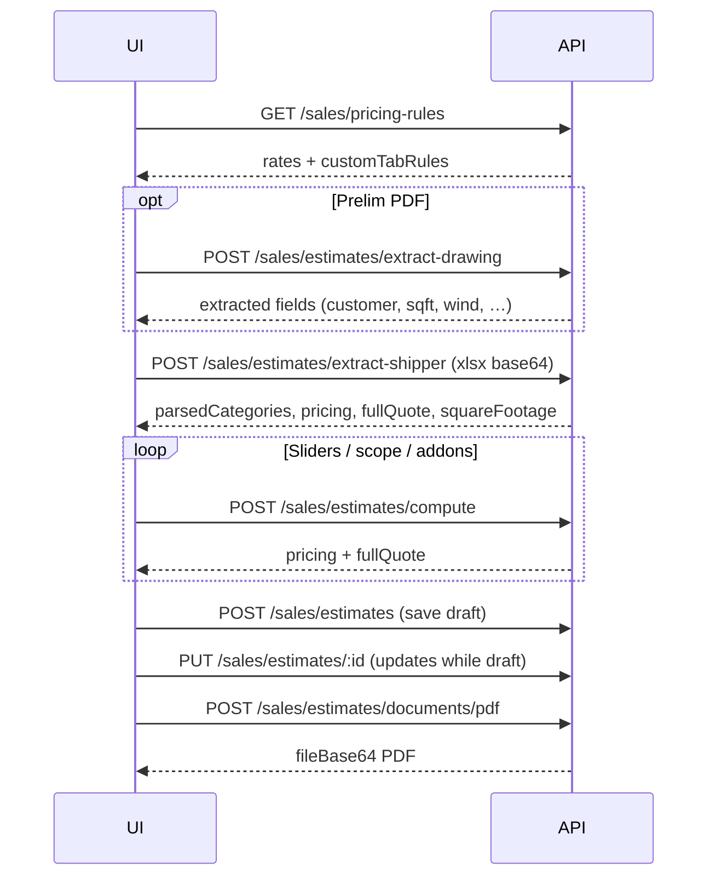

# Frontend handoff — PEMB / Storage quoting & extraction API

Wire the **Sales (and Admin) quoting UI** to the backend engine that mirrors the standalone **`SM-QuotingTool-v5 (31).html`** tool (shipper parse, pricing, tax, PDFs).

**Full API reference (payload examples, pricing math):** [`docs/ai-quoting-tool-api.md`](../ai-quoting-tool-api.md)

**Reference UIs in repo**

| File | Purpose |
|------|---------|
| `SM-QuotingTool-v5 (31).html` | Standalone source of truth (client-side logic) |
| `SM-QuotingTool-API.html` | Same flows calling this backend |

---

## Base URL & auth

| Environment | API base |
|-------------|----------|
| **Render (deploy branch `shubham-changes-13-aug`)** | `https://mr-storage-backend-025k.onrender.com/api` |
| **UAT** | `https://uat.flyweistechnology.com/api` |
| **Local** | `http://localhost:5001/api` (or your `PORT`) |

Login (staff):

```http
POST /auth/login
Content-Type: application/json

{ "email": "...", "password": "..." }
```

Use **`data.accessToken`** on every quoting request:

```http
Authorization: Bearer <accessToken>
```

| Panel | Prefix | Role guard |
|-------|--------|------------|
| Sales | `/sales/estimates`, `/sales/pricing-rules` | `sales` |
| Admin | `/admin/estimates`, `/admin/pricing-rules` | `admin` (same handlers; admin can see all estimates) |

Standard envelope:

```json
{ "success": true, "message": "...", "data": { } }
```

Errors: `{ "success": false, "message": "..." }` with HTTP 4xx.

---

## Recommended UI flow (PEMB)



**Storage COG:** replace shipper step with `POST /sales/estimates/extract-storage-cog`, then `POST /sales/estimates/compute-storage` when editing, save with `jobType: "Storage"`.

---

## Endpoints summary

| Step | Method | Path |
|------|--------|------|
| Load / save user rates | GET, PUT | `/sales/pricing-rules` |
| Prelim PDF extraction | POST | `/sales/estimates/extract-drawing` |
| Xshipper `.xlsx` parse + price | POST | `/sales/estimates/extract-shipper` |
| Storage COG `.xlsx` parse | POST | `/sales/estimates/extract-storage-cog` |
| Re-price without re-upload | POST | `/sales/estimates/compute` |
| Re-price storage | POST | `/sales/estimates/compute-storage` |
| COGS override preview | POST | `/sales/estimates/cogs/preview` |
| Margin override preview | POST | `/sales/estimates/margin/preview` |
| Sales tax by ZIP | GET | `/sales/estimates/tax-lookup/:zip` |
| HTML preview (quote/SOW/contract) | POST | `/sales/estimates/documents/preview` |
| PDF download | POST | `/sales/estimates/documents/pdf` or `.../:estimateId/documents/pdf` |
| Quote history KPIs | GET | `/sales/estimates/history/summary` |
| CRUD drafts | GET, POST, PUT, DELETE | `/sales/estimates`, `/sales/estimates/:estimateId` |

Admin: same paths under `/admin/...`.

---

## File upload pattern (drawing / shipper / COG)

All extraction endpoints expect **JSON + base64** (not multipart):

```json
{
  "fileBase64": "<raw base64 or data:...;base64,...>",
  "fileName": "shipper.xlsx"
}
```

Optional quote controls on **extract-shipper** and **compute** (match HTML sliders):

| Field | Default | Notes |
|-------|---------|-------|
| `jobType` | `PEMB` | `Storage` for COG flow |
| `scope` | `both` | `supply` \| `install` \| `both` |
| `roof` | `screw-down` | or `standing-seam` |
| `install` | `medium` | `easy` \| `medium` \| `hard` \| `tall-hard` |
| `squareFootage` / `sf` | `0` | On **first shipper upload**, send `0` and `useManualSquareFootage: false` so SF = `round(totalWeightLbs / 9)` |
| `useManualSquareFootage` | `false` | Set `true` after user edits SF; send on `/compute` |
| `blendPct` | `50` | Vendor blend 0–100 |
| `installCostPerSf`, `sellPerSf` | from rules | Optional overrides |
| `steelFinish` | `red-iron` | `galvanized` optional |
| `matMuOverride` / `matMuPct` | — | Material markup multiplier |
| `freightOverride` | — | Flat freight override |
| `deletedRowKeys` | `[]` | Rows user removed in UI |

**extract-shipper response (keep in client state):** `parsedCategories`, `tabSummary`, `pricing`, `fullQuote`, `squareFootage`, `squareFootageMeta`, `weightByCategory`, `totalWeightLbs`, `unmappedTabs`, `extractionCoveragePct`.

**compute request:** send **`parsedCategories`** from last extract (required) plus the same control fields. Response updates `pricing` and `fullQuote` (addons/tax/COGS/margin when included).

---

## Save & load estimate

**Create draft**

```http
POST /sales/estimates
```

Minimum useful body:

```json
{
  "leadId": "<optional Mongo lead _id>",
  "jobType": "PEMB",
  "scope": "both",
  "leadCompanyName": "Customer LLC",
  "squareFootage": 1505,
  "parsedCategories": { },
  "pricingResult": { },
  "fullQuoteResult": { },
  "tabSummary": [],
  "sourceFileName": "shipper.xlsx",
  "status": "draft"
}
```

If `leadId` is set, sales user must be **assigned** to that lead.

**Update:** `PUT /sales/estimates/:estimateId` — only while `status === "draft"`.

**Read:** `GET /sales/estimates/:estimateId` — includes `conversion` hint if linked to a `Quotation`.

Persist the same blobs the HTML tool keeps: `extractedDrawingFields`, `quoteControls`, `pembAddOns`, `concreteAddon`, `insulationAddon`, `salesTax`, `cogsOverride`, `marginOverride`, `contractDetails`, `drawingAttachments`.

---

## PDF / preview

**Preview HTML**

```json
POST /sales/estimates/documents/preview
{
  "pricingResult": { },
  "fullQuoteResult": { },
  "leadCompanyName": "...",
  "sections": ["quote", "sow", "contract", "drawings"]
}
```

Or pass `"estimateId": "..."` to render from saved draft.

**PDF**

```json
POST /sales/estimates/documents/pdf
{ "estimateId": "...", "sections": ["quote", "sow", "contract"] }
```

Response:

```json
{
  "success": true,
  "data": {
    "fileName": "Customer-assembled.pdf",
    "mimeType": "application/pdf",
    "fileBase64": "...",
    "sizeBytes": 123456
  }
}
```

Decode base64 in the browser: `atob` → `Uint8Array` → `Blob` → download link.

---

## Pricing rules (per user)

```http
GET /sales/pricing-rules
PUT /sales/pricing-rules
```

First GET auto-creates defaults from the HTML tool. **`customTabRules`** on the user’s rules doc are applied automatically during **extract-shipper** (do not resend rules in the upload body).

---

## Frontend integration checklist

1. [ ] Login → store `accessToken`; attach `Authorization` on all `/estimates` and `/pricing-rules` calls.
2. [ ] On quoting screen mount: `GET /pricing-rules`.
3. [ ] File inputs → read as base64 → `extract-drawing` / `extract-shipper` / `extract-storage-cog`.
4. [ ] Hold **`parsedCategories`** + latest **`pricing`** / **`fullQuote`** in state; call **`/compute`** on any slider/toggle (debounce ~300ms).
5. [ ] Shipper upload: **`squareFootage: 0`**, **`useManualSquareFootage: false`**; after user edits SF, set **`useManualSquareFootage: true`** on compute.
6. [ ] Save: `POST /estimates`; edits: `PUT /estimates/:id` while draft.
7. [ ] PDF button: `POST /documents/pdf` with `estimateId` or inline pricing payload.
8. [ ] Optional: `GET /tax-lookup/:zip` when ZIP field changes.
9. [ ] Compare totals against **`SM-QuotingTool-v5 (31).html`** for the same shipper file during QA.

---

## Related docs

- **Estimate → customer quotation:** [`docs/estimate-to-quotation-conversion-api-2026-09-03.md`](../estimate-to-quotation-conversion-api-2026-09-03.md)
- **Sales quotation send / PDF:** [`docs/sales-quotation-api-2026-08-28.md`](../sales-quotation-api-2026-08-28.md)

---

*Last updated: October 2026 — backend aligned with SM-QuotingTool v5/v6 PEMB engine on `shubham-changes-13-aug`.*
