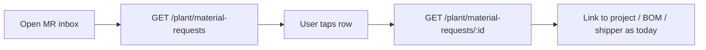
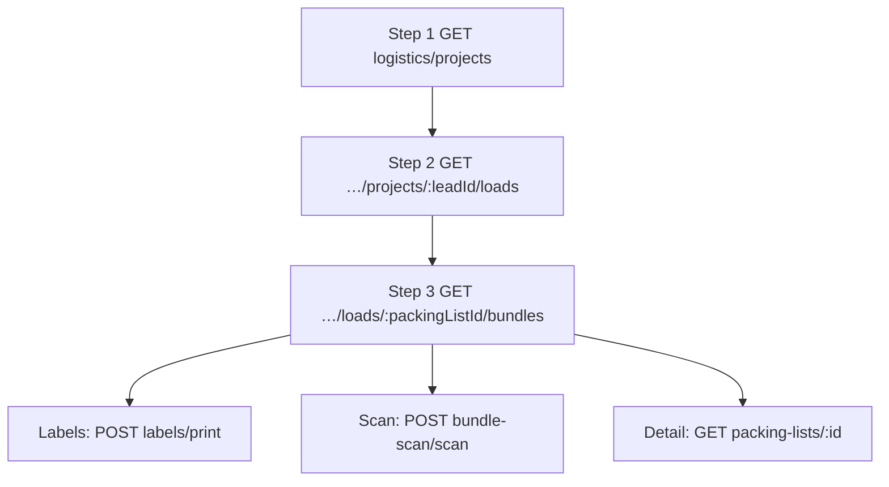

# Plant MR, Construction logistics (3-step), Notifications — frontend handoff

**Audience:** Plant app, Construction app, Customer app, Sales (notifications only)  
**Prod base:** `https://mr-storage-backend-025k.onrender.com/api`  
**Envelope:** `{ "success": true, "message": "Success", "data": { … } }`

**Also read:** [`frontend-integration-handoff-2026-10.md`](./frontend-integration-handoff-2026-10.md) (quotation, media, dashboard, deliveries, chat map)

---

## Overview

| Feature | Role | What changed |
|---------|------|----------------|
| Material requests inbox | **Plant** | New list/detail/filters under `/api/plant/material-requests` (scoped to plant-assigned projects) |
| MR create alert | **Plant** | Construction `POST …/material-requests` notifies all active **plant** users |
| Packing / labels / bundle scan nav | **Construction** | Shared **3-step** APIs: projects → loads → bundles |
| In-app notifications | **Staff + Customer** | Quotation send/accept/reject, customer chat, MR create (see matrix below) |

---

## 1. Plant — material requests

Construction (and customer portal orders) create `MaterialRequest` rows. Plant fulfills from projects in **plant scope** (`getScopedLeadIds` — same rules as plant packing lists / BOM).

### Auth

```http
Authorization: Bearer {staffToken}
```

Role: **`plant`** (admin may use admin construction MR APIs instead).

### List

```http
GET /api/plant/material-requests?page=1&limit=20&status=pending&search=MR-2026
```

| Query | Notes |
|--------|--------|
| `page`, `limit` | Pagination (max limit 100 on shared list service) |
| `status` | `pending` \| `approved` \| `rejected` \| `fulfilled` \| `cancelled` |
| `priority` | `low` \| `medium` \| `high` \| `critical` |
| `source` | `construction` \| `customer` |
| `projectId` / `leadId` | Filter one project (must be in plant scope) |
| `department`, `requestedBy`, `buildingLabel`, `siteLocation` | Optional |
| `search` | Matches `requestId` (regex) |
| `startDate` / `endDate` or `dateFrom` / `dateTo` | Filter `requestDate` |

**Response `200` (abbreviated)**

```json
{
  "success": true,
  "message": "Success",
  "data": {
    "scope": "plant",
    "materialRequests": [
      {
        "requestId": "MR-2026-00142",
        "_id": "66f1a2b3c4d5e6f7a8b9c0d1",
        "source": "construction",
        "project": {
          "leadId": "6ac4e5e6570533c2c601ed40",
          "projectName": "Adam Warehouse",
          "jobId": "JOB-1042",
          "location": "Austin, TX"
        },
        "siteLocation": "Building A",
        "department": "Framing",
        "requestedBy": {
          "userId": "64abc…",
          "name": "Site Super",
          "email": "super@example.com",
          "role": "construction"
        },
        "requestedItems": [
          { "name": "26ga Panel", "quantity": 120, "unit": "LF", "notes": "" }
        ],
        "itemCount": 1,
        "requestDate": "2026-10-01T10:00:00.000Z",
        "requiredBy": "2026-10-15T00:00:00.000Z",
        "priority": "high",
        "status": "pending",
        "totalAmount": 0,
        "createdAt": "2026-10-01T10:00:00.000Z",
        "updatedAt": "2026-10-01T10:00:00.000Z"
      }
    ],
    "total": 1,
    "page": 1,
    "limit": 20,
    "stats": {
      "total": 1,
      "pending": { "count": 1, "amount": 0 },
      "approved": { "count": 0, "amount": 0 },
      "rejected": { "count": 0, "amount": 0 },
      "fulfilled": { "count": 0, "amount": 0 },
      "urgent": 1,
      "totalRequests": 1
    }
  }
}
```

### Detail

```http
GET /api/plant/material-requests/{requestId}
```

**Response `200`:** `{ "materialRequest": { …same row shape as list… } }`  
**403:** Request’s project not in plant scope  
**404:** Unknown id

### Filters metadata

```http
GET /api/plant/material-requests/filters
```

```json
{
  "success": true,
  "data": {
    "statuses": ["pending", "approved", "rejected", "fulfilled", "cancelled"],
    "priorities": ["low", "medium", "high", "critical"],
    "sources": ["customer", "construction"],
    "departments": ["Framing", "Trim"],
    "requestedBy": [{ "_id": "64abc…", "name": "Site Super", "role": "construction" }]
  }
}
```

### Plant UI flow



Plant **does not** approve MR via these routes (sales/admin review flows unchanged). Inbox is read + deep-link.

### Construction creates MR (triggers plant notification)

```http
POST /api/construction/material-requests
Authorization: Bearer {constructionToken}
Content-Type: application/json
```

```json
{
  "leadId": "6ac4e5e6570533c2c601ed40",
  "siteLocation": "Building A",
  "department": "Framing",
  "requiredBy": "2026-10-15T00:00:00.000Z",
  "priority": "high",
  "requestedItems": [
    { "name": "26ga Panel", "quantity": 120, "unit": "LF" }
  ]
}
```

**Response `201`:** `{ "materialRequest": { … } }`  
Each create pushes an in-app notification to every active **plant** user (`type: material_request`, `refModel: MaterialRequest`).

Status updates on construction side still notify the **requester** (`requestedBy`) when status becomes `approved` \| `rejected` \| `fulfilled`.

---

## 2. Construction — 3-step logistics navigation

Figma flows for **Packing lists**, **Label printing**, and **Bundle scan** share the same hierarchy:

1. **Projects** (construction-scoped leads + counts)  
2. **Loads** (packing lists / trucks for one `leadId`)  
3. **Bundles** (bundles on one load)

Use either the **canonical** `/logistics/*` paths or **aliases** (same handlers):

| Step | Canonical | Aliases (same response) |
|------|-----------|-------------------------|
| 1 Projects | `GET /api/construction/logistics/projects` | `…/packing-lists/projects`, `…/labels/projects`, `…/bundle-scan/projects` |
| 2 Loads | `GET /api/construction/logistics/projects/:leadId/loads` | `…/packing-lists/projects/:leadId/loads`, `…/labels/projects/:leadId/loads`, `…/bundle-scan/projects/:leadId/loads` |
| 3 Bundles | `GET /api/construction/logistics/loads/:packingListId/bundles` | `…/packing-lists/loads/:packingListId/bundles`, `…/labels/loads/:packingListId/bundles`, `…/bundle-scan/loads/:packingListId/bundles` |

Auth: **`construction`** or **`admin`**.

### Step 1 — Projects

```http
GET /api/construction/logistics/projects?search=adam&page=1&limit=20
```

Optional scope query (same as other construction lists): `businessUnit`, `status`, `projectId`.

**Response `200`**

```json
{
  "success": true,
  "data": {
    "projects": [
      {
        "leadId": "6ac4e5e6570533c2c601ed40",
        "projectId": "JOB-1042",
        "jobId": "JOB-1042",
        "projectName": "Adam Warehouse",
        "location": "Austin, TX",
        "lifecycleStatus": "active",
        "totalLoads": 3,
        "totalBundles": 24,
        "labelsPending": 5,
        "lastLoadUpdate": "2026-10-08T14:22:00.000Z",
        "packingListPlanId": "66aa…",
        "packingListPlanStatus": "in_progress"
      }
    ],
    "total": 1,
    "page": 1,
    "limit": 20
  }
}
```

| Field | Use in UI |
|--------|-----------|
| `totalLoads` | Step 2 entry badge |
| `labelsPending` | Label screen — bundles not yet printed |
| `totalBundles` | Bundle scan hub summary |

### Step 2 — Loads for project

```http
GET /api/construction/logistics/projects/6ac4e5e6570533c2c601ed40/loads?page=1&limit=50&status=ready
```

**Response `200`**

```json
{
  "success": true,
  "data": {
    "project": {
      "leadId": "6ac4e5e6570533c2c601ed40",
      "projectName": "Adam Warehouse",
      "jobId": "JOB-1042",
      "location": "Austin, TX"
    },
    "loads": [
      {
        "packingListId": "66bb…",
        "packingListNo": "PL-2026-0088",
        "truckLabel": "Semi 53 #1",
        "truckType": "SEMI_53",
        "status": "ready",
        "totalBundles": 8,
        "totalWeight": 42000,
        "maxLengthFeet": 48,
        "updatedAt": "2026-10-08T14:22:00.000Z"
      }
    ],
    "total": 1,
    "page": 1,
    "limit": 50
  }
}
```

### Step 3 — Bundles on load

```http
GET /api/construction/logistics/loads/66bb…/bundles?labelPending=true
```

| Query | Notes |
|--------|--------|
| `labelPending=true` | Only bundles where `labelPrinted` is not true (label screen step 3) |

**Response `200`**

```json
{
  "success": true,
  "data": {
    "project": { "leadId": "6ac4e5e6570533c2c601ed40", "projectName": "Adam Warehouse", "jobId": "JOB-1042" },
    "load": {
      "packingListId": "66bb…",
      "packingListNo": "PL-2026-0088",
      "truckLabel": "Semi 53 #1",
      "status": "ready",
      "totalBundles": 8,
      "totalWeight": 42000
    },
    "bundles": [
      {
        "bundleId": "66cc…",
        "bundleNo": "B-001",
        "bundleType": "panels",
        "title": "North wall panels",
        "totalWeight": 5200,
        "maxLengthFeet": 40,
        "status": "staged",
        "labelPrinted": false,
        "labelPrintedAt": null,
        "verified": false,
        "updatedAt": "2026-10-07T09:00:00.000Z"
      }
    ],
    "total": 8
  }
}
```

### Actions after navigation (unchanged legacy flat APIs)

| Screen | After step 3, call |
|--------|---------------------|
| Labels | `POST /api/construction/labels/print` with bundle ids; or `GET /api/construction/labels` for flat list |
| Bundle scan | `POST /api/construction/bundle-scan/scan` or `POST /api/construction/deliveries/scan-bundle` |
| Packing list detail | `GET /api/construction/packing-lists/:packingListId` |
| Mark ready / dispatch | Existing `POST …/packing-lists/:id/mark-ready` etc. |

### Flow diagram



**Plant parity:** Plant packing still uses `GET /api/plant/packing-lists/projects` (plant scope). Construction uses the APIs above (construction scope).

---

## 3. Global notifications

### Staff inbox

Mounted for authenticated staff (same guard as profile):

```http
GET /api/notifications?page=1&limit=20&type=quotation&read=false
GET /api/notifications/unread-count
PUT /api/notifications/{id}/read
PUT /api/notifications/read-all
DELETE /api/notifications/{id}
```

**List response shape**

```json
{
  "success": true,
  "data": {
    "notifications": [
      {
        "_id": "66dd…",
        "userId": "64abc…",
        "leadId": "6ac4e5e6570533c2c601ed40",
        "title": "Quotation rejected",
        "body": "Customer rejected quote QT-2026-0042: Pricing too high",
        "type": "quotation",
        "priority": "high",
        "isRead": false,
        "refId": "67890…",
        "refModel": "Quotation",
        "createdAt": "2026-10-09T12:00:00.000Z"
      }
    ],
    "total": 1,
    "stats": { "total": 10, "unread": 3, "highPriority": 1, "today": 2 },
    "page": 1,
    "limit": 20
  }
}
```

**Deep link:** use `refModel` + `refId` + optional `leadId`:

| refModel | Suggested screen |
|----------|------------------|
| `Quotation` | Sales quotation detail for `leadId` |
| `MaterialRequest` | MR detail (construction or plant route by role) |
| `Message` | Customer chat / direct chat for `leadId` |
| `Delivery` | Delivery detail |

### Customer inbox

```http
GET /api/customer/notifications?filter=all|unread|drawings|finance|meetings
GET /api/customer/notifications/unread-count
PUT /api/customer/notifications/{id}/read
PUT /api/customer/notifications/read-all
```

### Event matrix (new / updated)

| Event | Who gets notified | `type` | When |
|--------|-------------------|--------|------|
| Construction creates MR | All active **plant** users | `material_request` | Immediately on `POST /construction/material-requests` |
| MR status → approved/rejected/fulfilled | **requestedBy** user | `material_request` | Existing on construction status PUT |
| Quotation email send succeeds | **Customer** (`customerId`) | `quotation` | After async email job completes |
| Customer accepts quotation | **assignedSales** on lead | `quotation` | `POST …/quotation/approve` |
| Customer rejects quotation | **assignedSales** | `quotation` | `POST …/quotation/reject` |
| Customer posts project chat message | **assignedSales** | `chat` | `POST /customer/chat/:channel/messages` |

Other notifications (deliveries, tasks, meetings, drawings, etc.) pre-exist elsewhere in the codebase.

### Quotation + reject (customer) quick reference

Full reject loop: [`frontend-customer-quotation-reject-flow-api.md`](./frontend-customer-quotation-reject-flow-api.md)

```http
POST /api/customer/projects/{leadId}/quotation/reject
{ "reason": "…" }
```

After reject, sales cannot `PUT` the same quotation back to draft; create a **new** quotation → admin approve → send.

---

## 4. Error codes (shared)

| HTTP | Typical cause |
|------|----------------|
| 401 | Missing/expired token |
| 403 | Project outside role scope (plant MR detail, logistics loads) |
| 404 | Unknown id or project not in scope |

---

## 5. QA checklist

- [ ] Plant user with scoped projects sees MR list; MR on other plant’s project returns 403 on detail  
- [ ] Construction creates MR → plant badge increments on `/api/notifications/unread-count`  
- [ ] Construction logistics: project → loads → bundles matches flat `GET /packing-lists?leadId=` counts  
- [ ] Label screen: step 3 with `labelPending=true` matches bundles needing print  
- [ ] Customer reject → sales user sees `type: quotation` notification with reason in body  
- [ ] Quotation send email job completes → customer sees portal notification  

---

## 6. Related docs

| Topic | Doc |
|--------|-----|
| Customer quotation (full) | [`frontend-customer-app-quotation-api.md`](./frontend-customer-app-quotation-api.md) |
| Customer reject loop | [`frontend-customer-quotation-reject-flow-api.md`](./frontend-customer-quotation-reject-flow-api.md) |
| Construction dashboard / export | [`frontend-construction-dashboard-api.md`](./frontend-construction-dashboard-api.md) |
| Integration index | [`frontend-integration-handoff-2026-10.md`](./frontend-integration-handoff-2026-10.md) |
